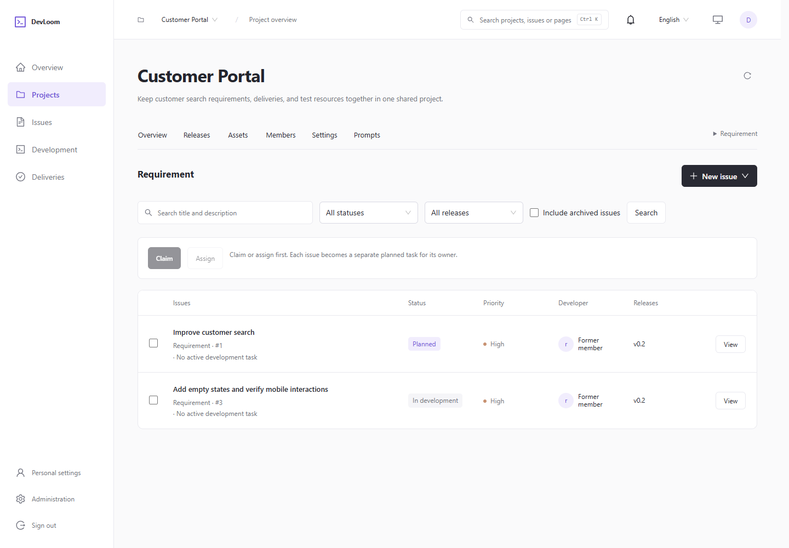
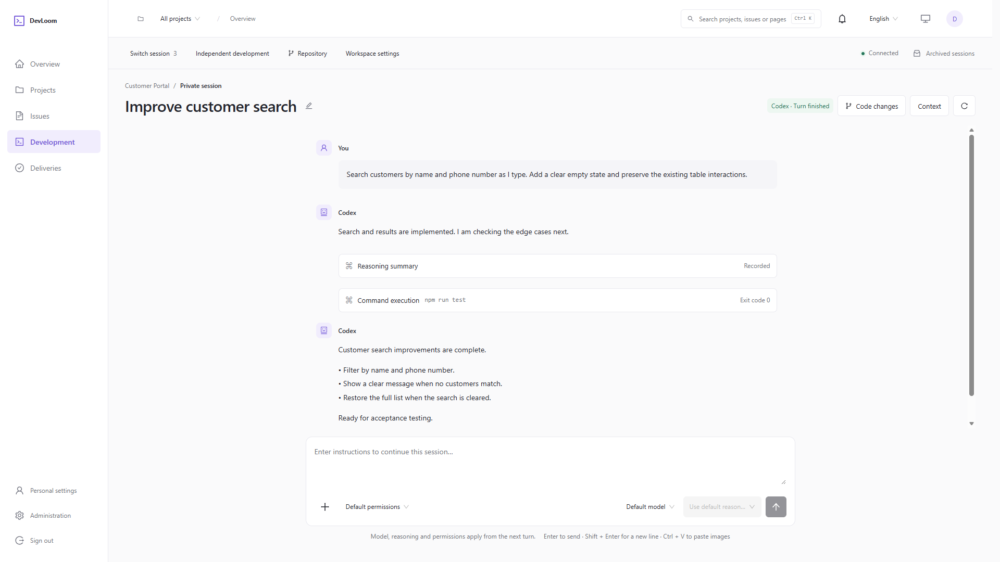
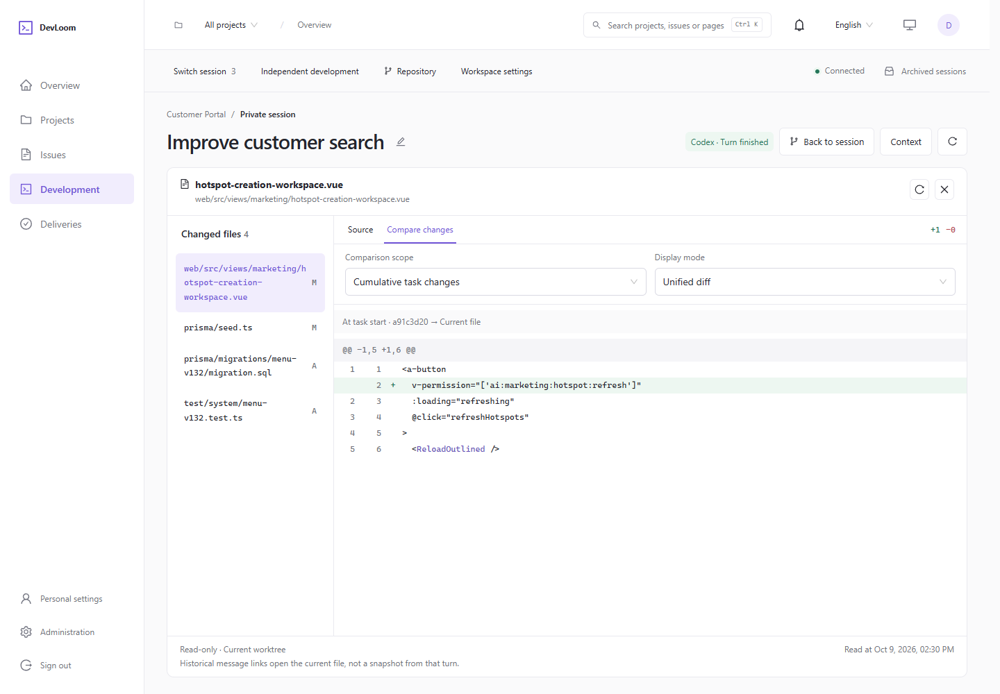
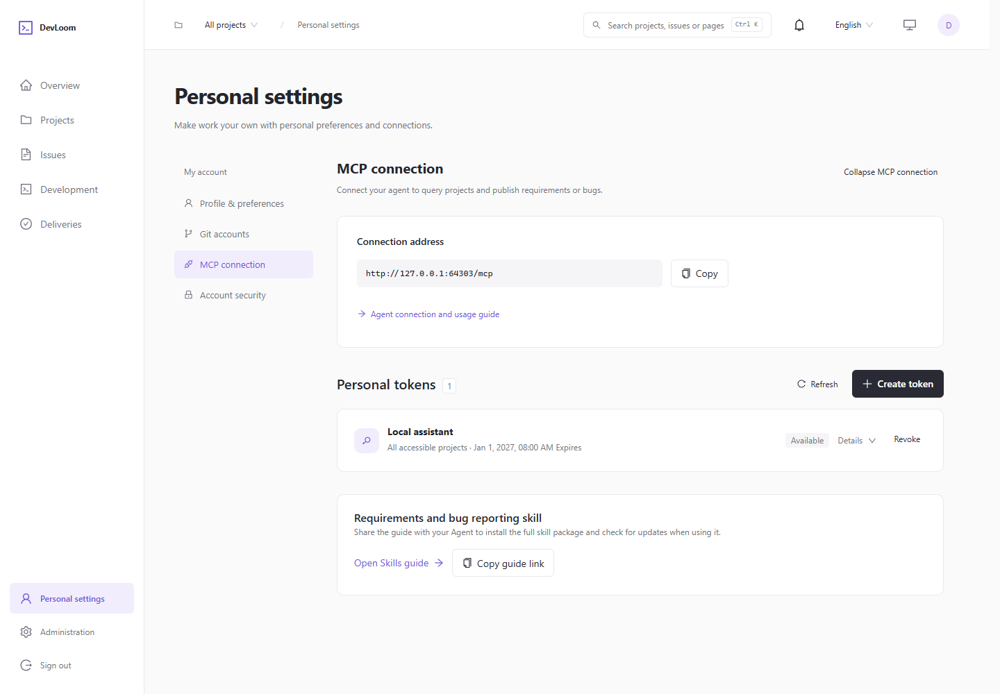

# DevLoom

**English** · [简体中文](README.zh-CN.md)

**Connect requirements, bugs, task assignment, and delivery. Develop with an Agent, directly in your browser.**

DevLoom is a web workspace for team development. Product and QA teams organize requirements, report bugs, and assign tasks. Developers work with an Agent in the browser to implement changes, inspect code, and submit their work for review and acceptance.

## What it solves

- **Lost context between planning and development**: Keep requirements, reproduction steps, owners, development tasks, and delivery records connected, so teams spend less time repeating information.
- **Scattered development tools**: Prepare repositories and runtime environments on the server. Team members use the browser to start development, give instructions, respond to approval requests, and inspect results.
- **Time spent organizing and assigning work**: Use an Agent through MCP to break down requirements and bugs, define acceptance criteria, create issues, and assign them to team members.

## How it works

Requirement / Bug → Claim or assign → Develop with an Agent on the web → Inspect changes and deliver → Accept or return for rework

1. **Organize issues**: Manage requirements and bugs by project and release, with descriptions, images, reference material, and acceptance criteria.
2. **Assign tasks**: Claim an issue or assign an owner to create a planned development task. Related tasks can be merged for implementation.
3. **Start development**: Choose a starting branch. The Agent works in an isolated Git worktree while you follow its progress, continue the conversation, and inspect code changes in the browser. You can also start independent development without linking an issue.
4. **Deliver and verify**: Submit delivery notes and verification evidence for a designated reviewer. If changes are needed, return the work and continue tracking it through the original issue.

Development runs through a common Agent adapter layer. **Codex is integrated today; Pi, Claude Code CLI, and other integrations are planned.**

## Plan and assign work through MCP

Create a token in **Personal settings → MCP access**, then give the generated setup instructions to an MCP-capable Agent. With the companion Skill, the Agent can query projects, releases, and members; check for duplicate issues; organize requirements or bugs; upload attachments; and assign development owners.

For example:

> Break this customer search requirement into independently deliverable issues, add acceptance criteria, target v0.2, and assign each issue to the appropriate frontend or backend owner.

Created and assigned tasks appear in the owner's planned task list. The developer then confirms when to start development in the web workspace. See the [MCP guide](docs/engineering/mcp.md) for setup details.

## Screenshots

The screenshots below show the current English interface with demo data.

**Requirements and assignment**: Track issue status, priority, and target release, then claim or assign development tasks.

**Web development sessions**: Keep working with the Agent, follow execution, add instructions, and review results.

**Code inspection**: Browse changed files, source code, and cumulative task diffs directly in the browser.

**MCP access**: Connect external Agents, find setup instructions, and manage personal tokens.

## Getting started

The server needs Node.js 22.13+ (LTS), PostgreSQL, Git, and the runtime for an integrated Agent. Team members access the workspace through a browser.

The detailed guides below are currently in Chinese:

- [Installation and configuration](docs/getting-started.md): Prerequisites, first launch, account setup, and troubleshooting.
- [User guide](docs/user-guide.md): Project collaboration, development tasks, sessions, and delivery.
- [Deployment](docs/deployment.md): Windows, Linux, and macOS deployment and service maintenance.
- [Engineering documentation](docs/engineering/index.md): Architecture, development conventions, and capability boundaries.
