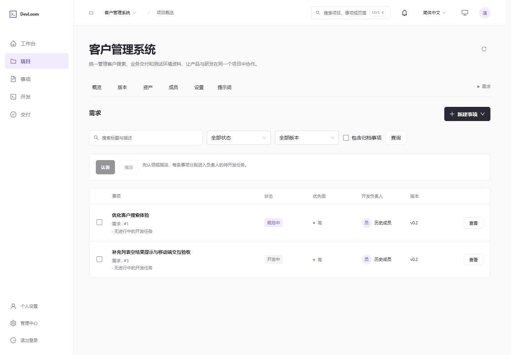
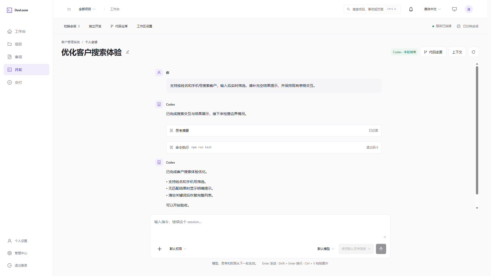
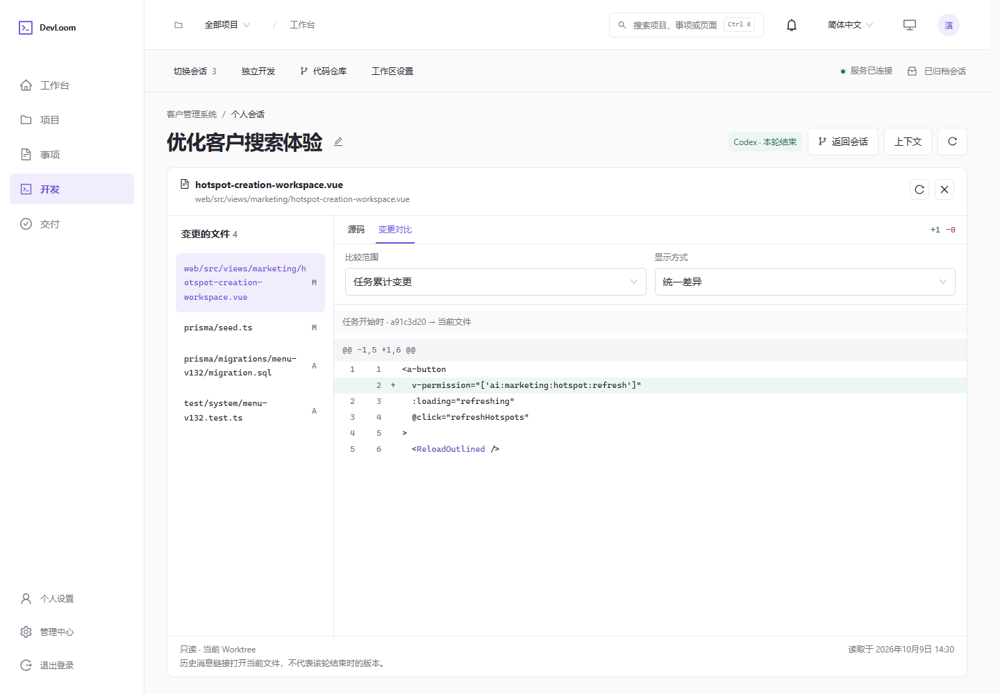
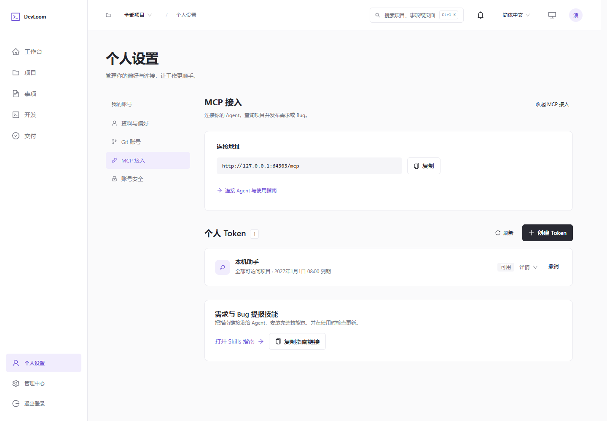

# DevLoom

[English](README.md) · **简体中文**

**打通需求、Bug、任务分派与开发交付，在浏览器里与 Agent 一起完成开发。**

DevLoom 是一个面向团队的 Web 开发工作台。产品和测试人员整理需求、提交 Bug、分配任务；开发人员直接在网页中与 Agent 沟通、推进实现、查看代码变更，再交付验收。

## 解决什么问题

- **需求与开发脱节**：把需求描述、复现资料、负责人、开发任务和交付记录关联起来，减少反复转述和遗漏。
- **开发入口分散**：服务端统一准备仓库和运行环境，成员通过浏览器即可发起开发、补充指令、处理审批和检查结果。
- **整理与分派耗时**：通过 MCP 让 Agent 协助拆解需求和 Bug，补充验收条件，发布事项并分配给团队成员。

## 怎么使用

需求 / Bug → 认领或指派 → Web 端 Agent 开发 → 查看代码与交付 → 验收或返工

1. **整理事项**：按项目和版本管理需求、Bug，附上说明、图片、参考资料与验收条件。
2. **分配任务**：认领或指派负责人，进入待开发任务；相关任务可合并处理。
3. **开始开发**：选择起始分支，Agent 在独立 Git worktree 中执行。网页中可持续对话、查看输出和代码差异，也支持不关联事项的独立开发。
4. **交付验收**：提交交付说明和验证记录，由指定人员验收；需要修改时退回，沿原事项继续跟进。

开发执行通过统一的 Agent 适配层接入：**目前已接入 Codex，Pi、Claude Code CLI 等计划中。**

## 用 MCP 拆解和分派需求

在「个人设置 → MCP 接入」创建 Token，将页面生成的配置指引交给支持 MCP 的 Agent，即可连接项目。结合配套 Skill，Agent 可以查询项目、版本和成员，检查重复事项，整理需求或 Bug、上传附件，并指派开发负责人。

例如，可以向 Agent 提出：

> 把这份客户搜索需求拆成可独立交付的事项，补齐验收标准，归入 v0.2，并分别指派给对应的前后端负责人。

发布和分派后，任务进入成员的待开发列表，由开发人员在 Web 端确认开始开发。接入方式见 [MCP 使用说明](docs/engineering/mcp.md)。

## 功能截图

以下为当前中文界面使用演示数据的截图。

**需求管理与任务分派**：查看事项状态、优先级和目标版本，认领或指派开发任务。

**Web 开发会话**：与 Agent 持续沟通，查看执行过程、补充要求并跟进结果。

**代码变更查看**：在网页中浏览变更文件、源码和任务累计差异。

**MCP 接入**：连接外部 Agent，获取接入指引并管理个人 Token。

## 加入交流群

  
   
  <strong>DevLoom 交流 10 群</strong>
   
  扫描二维码，和其他 DevLoom 用户一起交流；点击图片可查看大图。
   
  入群二维码会定期更新，如已失效，请重新打开本页面获取最新二维码。

## 开始使用

服务端需要 Node.js 22.13+（LTS）、PostgreSQL、Git 和已接入的 Agent 运行环境；团队成员通过浏览器访问。

- [安装与配置](docs/getting-started.md)：环境准备、首次启动、账号配置和常见问题。
- [使用手册](docs/user-guide.md)：项目协作、任务开发、会话与交付。
- [部署说明](docs/deployment.md)：Windows、Linux、macOS 部署与服务维护。
- [工程文档](docs/engineering/index.md)：架构、开发规范与能力边界。
