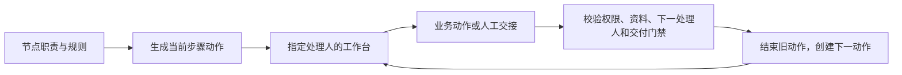

# 职责、流程步骤与个人工作台

2026-10-16。本文描述事项、开发、交付与验证的串行交接；完整产品目标及后续阶段见[研发全流程方案](../prd/tapd-alignment-and-orchestration.md)。本项目独立提供这些能力，不与 TAPD 同步。

## 详情中的开发分派资料

2026-10-22：事项详情 `GET /api/projects/:id/issues/:issueId` 增加只读 `developmentAssignment: { actorId, developerId, createdAt, method } | null`，`method` 为 `claimed` 或 `assigned`。复用已有 `issue_history` 的 `assigned` 记录与人员目录，不增加数据库字段或迁移。按 `after.revision` 确定最近一次分派，时间相同也不依赖随机 ID 顺序；只读取不晚于当前事项修订的记录，并校验记录执行人与当前开发负责人一致。没有对应证据或负责人已释放时返回 null，不以提报人、创建者、最近编辑者或合并人推断分派人。查询仅返回摘要，不暴露历史正文；沿用 `issue.view` 授权及返回前复核。

事项页和开发页共用分派与事项信息组件。开发页按所选来源事项读取当前资料，保留原任务范围快照用于执行；多个来源不能合并成一个虚构的提报人或分派人。独立任务显示无来源资料，不伪造人员；任务执行者、事项开发负责人和 Agent 状态各自保留原始语义。

## 删除无效事项

2026-10-19：网页详情的「更多操作 → 删除事项」用于清理不明确或误提报的需求/Bug。独立权限 `issue.delete` 依赖 `issue.view`，纳入产品协作预设；既有成员和部门权限不自动扩权。项目或发布版本归档后仍只读。

`POST /api/projects/:id/issues/:issueId/delete` 接受确认时的 `revision`，在同一 Serializable 短事务中复核权限、修订、所有开发任务关联（含已取消、完成、合并）和所有交付记录；任一关联存在均拒绝删除。并发编辑/指派与删除冲突返回 409，刷新后重新确认。

删除记录 `deletedAt`、递增修订、结束未完成步骤并写入事项历史和 `issue.deleted` 审计。来源身份、正文、讨论、附件及既有资产关联保留在数据库；公开读取、附件下载、项目及全局列表/搜索、工作台、项目/版本统计和资产关联展示均排除已删除事项。版本归档不再被这些事项阻塞。页面不提供恢复操作，不删除任务、会话或工作目录。

创建请求 ID 和事项编号继续占用；网页与 MCP 的原创建请求不能复活事项，MCP 查询及幂等结果回放也不返回已删除事项内容。人工删除沿用浏览器身份与 CSRF；MCP 的 `delete_issue` 使用独立 `issues.delete` scope，并复用相同项目权限和关联门禁，稳定 requestId 支持安全重试和删除回执查询，详见 [MCP 契约](mcp.md)。网页删除成功返回原筛选列表并清理该事项的选中状态；确认窗展示标题和访问影响，失败保留错误并要求重新读取。

## 人员与处理权

2026-10-26 列表筛选：全局与项目事项支持 `releaseId/status/priority/ownerId/reporterId`，开发支持 `releaseId/status/ownerId/reporterId`，交付支持版本与提报人并保留验收状态；多个值用逗号分隔，最多 50 个不同标识。同一维度取并集、不同维度取交集，过滤先于总数和分页。`none` 表示未排期、未分派或无来源事项；开发状态缺省为 `not_cancelled`，`all` 显式包含取消。全局开发仍限定当前执行者，项目任务列表保留原范围与权限。

任务的提报人从当前关联事项去重取得，不用执行者或创建者代替。每条交付使用其 `issueId` 对应的提报人和版本；无关联事项时提报人为空，版本来自其独立任务（若有）。筛选候选只来自授权范围；全局开发仅返回本人全部任务涉及的版本和人员，不读取其他任务或事项流程。响应返回前复核权限，撤权时整份结果及候选数据作废。图片预览映射只使用同项目、同事项且哈希与任务快照一致的已验证附件，不重写快照正文或执行记录。

| 字段 | 含义 | 如何维护 |
| --- | --- | --- |
| `reporterId` | 提报业务问题的人 | 创建默认当前账号，可由有 `issue.assign` 权限的人调整 |
| `businessOwnerId` | 对业务结果负责，并协调缺失或失效的分派 | 创建默认当前账号，不能为空 |
| `developerId` | 最近一次分配的开发负责人 | 由开发任务认领、指派、转派和取消维护；事项内容接口不直接写入 |
| `qaOwnerId` | 测试验证职责 | 创建和编辑事项时必填 |
| `acceptanceOwnerId` | 业务验收职责 | 创建和编辑事项时必填 |
| `watcherIds` | 关注事项的人 | 不授予操作权限，也不生成待办 |
| `processing.handlerId` | 当前流程步骤的处理人 | 按连线交接规则选择；可采用职责、明确选择的人、本次执行人、验证人或本轮交付提交人 |

系统权限与业务分派相互独立。管理员可以管理项目，但不会因此自动成为任何步骤的处理人或交付验证人。普通成员的部门上限、项目授权、账号状态仍在读写时校验。原创建人 `createdById` 是不可改写的审计身份，不等同于可调整的提报人。

## 流程驱动的交接

系统设置中的流程图支持节点的 `allowAssignment`（认领/指派）、`allowDevelopment`（执行门禁）、`active`（进入即处理中），以及 `handler`（五种职责）、`category`（planning/work/development/verification）；连线配置 `trigger`、`actor`、`assignment`，并支持 `requiredFields`、`requireDelivery`、`requireAcceptedDelivery`、权限和原因门禁。同一来源节点的同一自动事件只能配置一条出线。省略事件的新连线为人工流转，状态名称和额外评审节点仍可自由编排。默认规划节点交给业务负责人，开发节点交给开发人，测试节点交给 QA，Bug 的关闭确认交给业务验收人。新节点省略职责时默认为业务负责人，省略类别时为一般处理。

事项表单保留类型默认字段，并显示所绑定流程任意连线要求的文本字段及已有内容；需求可填写流程要求的复现资料，需求和 Bug 均可逐条填写验收标准。标准为有序字符串数组，交付冻结每个完整条目而不按内部换行再次拆分。新建表单使用当前已发布流程，已有事项详情和编辑始终使用其绑定版本，不因系统发布新版本而丢失资料入口。

验收标准迁移在数据库事务内将旧版顶层列表拆分为条目，保留多行、嵌套和代码块；无法可靠识别的正文整体作为一条。旧事项原文、受影响开发任务快照、任务关联快照和 MCP 结果各自保存在 `acceptance_criteria_*_backup` 数据库表中供核对。应用只接受新数组格式；旧客户端须升级，旧格式请求不可按原参数重试，已完成请求可通过 `get_request_result` 查询。

每个事项最多一个未结束的 `WorkAction`，数据库部分唯一索引保护并发。步骤持有流程版本、节点、序号、处理人、类别、修订及开始/结束时间。事项修改、人员调整、步骤交接、历史写入在同一短事务内完成。重新进入同一节点生成新轮次；旧事项修订或旧动作修订不能操作新步骤。

通用“开始处理”和 `/step/start` 已移除。人工 `/transition` 只接受 `trigger=manual` 的连线，并校验 `revision`、所选边权限、操作主体与目标处理人；允许选择处理人的连线可携带 `handlerId`。非开发、非当前交付验证步骤可通过 `/step/assign` 显式转派。处理资格要求 `issue.view` 和目标节点至少一条出线的权限，类别只影响工作台栏目。发布版本不可变，后续发布不重绑在途事项。

默认需求：规划中 → 认领/指派后待开发 → 真实执行开始后开发中 → 提交交付后待验证 → 开始验证后验证中 → 验证通过后已实现；也允许从待验证直接提交验证结论。退回进入待返工，再由明确继续开发或重新提交交付推进。Bug 在验证通过后增加业务验收环节。

业务事件包括 `development.assigned`、`development.started`、`delivery.submitted`、`verification.started/accepted/returned`。操作主体为当前处理人、开发执行人、本轮验证人或有分派权限的人；认领允许有 `session.start` 的本人。认领/指派同步状态与当前处理人，不启动执行器。

真实开始使用已持久化的 Agent `turn-started`。启动前记录事项修订和动作轮次，`workflow_execution_events` 按任务/turn 去重并保存 pending/applied/blocked；读取任务或工作台可恢复未完成交接。修订或权限变化时显示流转受阻，`POST /tasks/:id/workflow/retry` 仅由执行人重试原业务事件，仍须是原动作轮次，不重放 Agent。执行发送前在短事务中复核流程并记录 starting，阻止并发送验或结束任务越过执行门禁。

提交交付保留开发任务。所有已关联事项进入完成/取消节点、没有未解决交付且执行已经结束后自动完成任务并释放认领；从未启动且没有派发意图或执行事件的待开发任务也可自动收尾。多个事项分别流转，局部送验不推进其他事项。首次启动仅发送当前允许开发的范围，并持久化 startIssueIds 供派发前复核，保留任务完整来源快照；待验证或已结束范围不作为首次执行范围发送。已有会话允许在全部送验及验收完成后续聊；仅当前允许开发的未结束任务范围触发 development.started，空范围清除旧流程意图，验证状态和处理人不变。待验证期间禁止修改任务范围或执行人；已有交付记录的任务禁止合并，以保留交付来源。全部送验后工作台不再生成启动开发待办；明确继续执行时展示真实运行或审批动作，结束后不重建开发待办。

### 无需启动 Agent 的交付与版本采用

系统管理接口额外返回可载入的 `recommendedDefinition`。推荐需求/Bug 模板从待开发节点配置「线下处理」，复用已有成果提交与验证流程；规划节点不配置直接送验出线。运行时只读取事项绑定的流程出线，不按节点 ID、名称、顺序或类别额外限制送验；自定义流程可将同一事件配置到其他合法节点。退回连线采用 `assignment=submitter`，交给当前有效交付的作者；仅人工流转和 `verification.returned` 可配置此规则。返工节点允许当前处理人无任务重提，也允许显式认领/安排开发。已发布的默认 v1 定义不变，载入模板只替换浏览器草稿，保存、发布均需明确操作。

事项 DTO 的 `deliverySubmission` 返回 `allowed/taskId/label/transitionId`，开发任务 DTO 返回逐项 `scope.submission` 和 `canSubmitDelivery`。`label` 直接取当前 `delivery.submitted` 连线的 `name`，不根据 planned、是否有任务或是否运行过 Agent 切换固定名称。入口受流程出线、当前处理人、交付创建及流转权限、归档和任务来源约束。没有开发认领时，合法人工送验不要求会话权限，也不创建开发任务。已有当前认领必须携带其 `taskId`；仅本人、范围匹配、从未启动且没有工作区/run key、启动意图或执行事件的 planned 任务可提交已有成果。真实执行仍须已结束，未知结果不能绕过。审计记录 `submissionSource=manual|existing|agent`，不制造执行开始事实。

发布新流程不自动重绑旧事项。`GET /api/projects/:id/issues/:issueId/workflow-upgrade` 预览，`POST` 同一路径采用最新已发布版本，均要求 `issue.view/issue.assign/issue.transition`。仅当前动作 ready、非验证和非活跃的未结束节点、无交付及执行身份/意图/事件时可采用；关联历史任务仅允许 planned/cancelled/merged 且从未执行。以稳定节点 ID 映射并核对类型、职责、类别、认领和开发属性，复核处理人资格。提交包含 UUIDv4 `requestId`、`issueRevision/actionRevision/targetVersionId/tasks[{id,revision}]` 和必填 `reason`。事务内重新核对全部快照；同请求同内容只返回原结果，修改内容或状态冲突返回 409。

版本采用保留事项、任务身份及任务快照，结束旧动作并建立新版本动作；历史保存 `workflow.upgraded`、原新版本、处理人、原因和请求快照。已有交付链、正在处理或执行结果未知的事项不能采用。不新增表、字段或迁移，不自动修数。方案及上线顺序见[无需启动 Agent 的成果送验](../prd/delivery-without-agent.md)。

取消开发任务会清空开发负责人，若流程仍处于开发节点，业务负责人收到“分派处理人”。处理人权限撤销时，工作台也将其显示为业务负责人的分派修复动作。有管理权限的人可在事项详情调整职责；私人开发任务的转派仍通过既有开发任务接口。

开发执行人失去 `session.start`、`issue.view` 或有效项目成员资格时，关联事项的业务负责人收到“处理开发分派”，需具有 `issue.view/issue.assign`；合并任务通知每个关联事项的业务负责人，每人的队列中同一任务只出现一次。独立任务由创建人协调。任务修复已经覆盖同一开发人步骤的分派异常时，不再重复显示事项修复。未启动任务通过既有转派接口重新指定有效执行人，清除修复待办；已启动任务仍不可转派，须协调恢复权限并核对原执行，遵守原有结束/取消门禁，不自动重启。

流程没有自动启动 Agent、合并代码或部署的能力。认领和分派只创建待开发任务，执行仍需执行人明确启动。系统全局需求/Bug 流程继续生效；编排页面提供单步事件规则预览；项目独立流程、任意外部事件自动化与并行会签属于后续阶段。

## 三栏与通知

`GET /api/workbench/actions` 接收 `bucket=todo|doing|verify`、`projectId`、`query`、`limit`、`offset`，返回 `items/total/nextOffset/counts`。`counts` 为相同项目及搜索范围内的三栏总数，不被当前 bucket 截断。首页与“查看全部”均调用此接口。

| 栏目 | 内容 |
| --- | --- |
| 待推进 | 本人未开始的步骤、本人待开发任务、阻塞的审批/问题、已结束执行待整理的成果、执行结果不明待核对、本人被退回的交付、明确交给业务负责人的分派修复 |
| 处理中 | 本人已开始的一般步骤，或本人实际 preparing/starting/running 的开发执行 |
| 待验证 | 本人被分派的测试/验收步骤与交付；已经开始验证的也留在这一栏 |

权限、项目/版本归档、开发任务结束状态都参与过滤。没有权限的人、关注人、仅提报事项的人不因这些关系产生个人动作。验收步骤与同一人可见且可操作的 pending 交付验证重合时优先显示交付；交付撤权或仅剩分派修复动作时不隐藏其有权处理的事项步骤；本人退回交付与本人事项动作去重。提交交付会完成本轮开发步骤，并创建验证步骤。开发类别步骤仅在步骤处理人与活跃开发任务执行人为同一人时合并展示为开发任务；不同人的步骤与任务各自保留。阻塞动作优先，其后按截止日期、优先级、创建时间稳定排序。

开发任务只向有权限的执行人暴露本人工作区/run key；分派修复只返回公开任务标题和任务入口，不返回私人工作区、run key、提示词、会话消息或代码，通知沿用同样边界。没有开发任务的本人会话审批按会话聚合，已结束开发任务的旧审批不会作为独立会话重新出现。结果未知时入口只引导核对原执行，不触发自动重试。

`GET /api/workbench/attention` 直接使用同一动作快照，只提醒待推进与待验证的动作；审批/问题按所属任务或会话聚合。首次打开不补发通知、账号切换重置基线、失败快照不重置去重记录。事项、开发、交付的原资源列表继续用于浏览与跟踪，不作为首页三栏的数据定义。独立的“等待他人/关注/可认领”动作视图尚未实现。

## 交付验证与返工

- 发布必须有 `reviewerId`；省略时仅可采用事项明确配置的 QA/验收人，不能默认作者或所有有验收权限的人。`GET /api/projects/:id/reviewers` 返回当前有效且具备 `deliverable.review` 的候选人；带 `issueId` 时还须有目标流程节点的处理资格。各发布入口要求明确选择验证人。
- 发布可带稳定 `requestId` 和 `issueRevision`；重试不得改变内容。`/deliveries/batch` 接受 1–20 个不同事项的 items，全部校验通过后一起送验。默认开发提交必须来自本人的当前任务；自定义流程可配置由当前处理人提交无代码交付。
- `/deliveries/:id/start` 记录验证开始；开始后仍属待验证。`/review` 仅允许指定验证人，通过要求全部核对项，退回要求原因，均检查修订号和当前权限。
- 发布、开始验证、通过和退回分别按配置的业务事件同步事项与处理人；`/review` 不再接受可选状态参数。交付绑定当前动作 ID，只有最新交付及其当前验证轮次可操作。所有交接、资料门禁和交付写入在同一事务，失败一起回滚。
- 退回后原发布人获得“修改并重新提交”。新发布携带 `supersedesId/previousRevision`，来源不变；有任务来源的交付仍仅原作者可重提。无任务的人工返工可由显式接手的当前处理人重提，也可明确安排开发后关联当前任务，继续原交付链；不因系统管理员身份自动授权。唯一约束防止两个后继。原交付和验收意见保留，下一修订重新生成清单和待验证动作。
- 待验证交付阻止取消开发任务。退回后保留原任务继续返工；若明确取消原任务，原作者须明确认领新的返工任务，并沿同事项原交付链重提。原任务保持取消，不会自动复活。独立任务的交付可沿原链修订证据。
- 清理会话或 Worktree 不改变交付和任务状态。项目事项任务的原目录已清理时，退回交付和任务详情提供「创建返工任务」确认；该显式替换操作可将合并任务的全部事项转入新任务，其他待验证交付继续归属原任务和验证轮次。原任务取消并保存新任务关联，认领转移到同一执行人的新任务；创建与启动分开。原目录保留时继续原会话，不创建替换任务。执行和删除摘要见[账号与数据库](accounts-and-database.md)。
- 从事项、任务或会话提交返工成果时，表单读取最新退回交付及验收意见，沿原交付链提交并关联当前任务；批量送验逐项使用各自的原交付 ID 和修订号。原交付读取失败时保留草稿并提供重试。
- `/deliveries/:id/assign` 接收 `revision/reviewerId`，具有 `issue.assign` 和协作权限的人可调整 pending 交付的验证人；保留本轮验证进度和开始时间，旧验证人不可操作。验证人撤权时，关联事项的业务负责人（独立交付则为作者）获得分派修复动作。
- `requireAcceptedDelivery` 检查最新交付的结论；旧交付通过不能满足新的 pending/returned 交付。版本归档同时拦截未验证及尚未重提的退回交付。
- 已完成任务继续会话时，版本归档仍检查实际执行终态；执行中或状态不明不能归档。续聊派发与归档在事务内复核版本及执行状态，避免归档后仍发出新一轮执行。

## 数据部署边界

`20261014200000_workflow_responsibilities` 引入职责和步骤；`20261015120000_workflow_handoffs` 增加交付动作/幂等标识、明确处理人、持久执行事件并更新默认流程。按用户要求不做历史业务数据转换。迁移遇到已有事项、开发任务、交付或修改过的系统流程时明确失败并回滚，要求以新库部署；不会自动清表，也不会移动或删除 Git、Worktree、session/source 数据。

本次仅在隔离测试数据库验证迁移及行为，不部署到现有业务数据库。验证入口见根 AGENTS 和[联动验收记录](../reviews/workflow-handoffs-2026-10-15.md)。

## A 方案与流程按钮契约（2026-10-16）

- 事项详情侧栏集中显示当前操作；同一成果表单在弹窗内使用。流程版本单独展示，仅 `workflow.latestPublishedVersion > workflow.version` 且具备原有权限和状态资格时显示采用入口。最新已发布版本随事项查询关联读取；未发布草稿不计入。
- 单条、批量指派后保留当前路由、筛选、页码和详情实例，刷新列表及当前事项。查看开发任务是显式导航。
- 事项、讨论、任务中的送验名称以及成果弹窗标题和提交按钮使用同一配置名称；合并任务存在多个动作名称时先进入通用成果整理，再按所选事项显示实际动作。
- 开始验证、验证通过和退回的名称来自对应事件连线；`workflowActions[].allowed` 综合所需权限、操作主体、当前验证人及交付轮次。无配置或无权的验证按钮隐藏。返工入口还要求当前事项的送验能力允许。
- 人工流转按钮采用选中连线名称。任务开始按钮读取当前允许开发范围中的事件名称；多事项存在不同动作时保留通用执行准备入口。工作台和通知通过 `workflowLabel` 展示配置名称，自定义名称不按界面语言翻译。
- 流程模板打开只读预览和替换范围，确认后只载入浏览器草稿。交接预览读取当前草稿，展示目标、处理人规则和必填资料。保存、发布仍为独立的显式操作；保留画布、属性编辑和全屏功能。
- 跨项目开发列表与项目任务列表缺省 `status=not_cancelled`，只排除 cancelled；已完成、已合并仍可查询。显式 all 显示全部任务状态，cancelled 仅显示取消。过滤在数据库分页、计数之前执行；本人范围、项目授权和个人会话归档规则保持独立。事项关联历史视图显式传 all。

按钮反查范围与结论见[流程按钮审查](../reviews/workflow-actions-a-2026-10-16.md)。本轮没有新增数据库字段、迁移或修改生产数据。

2026-10-28：事项创建必须明确指定业务负责人、测试负责人和业务验收人；编辑后的三项均不得为空，历史缺失数据只在用户保存时补齐，不自动回填。MCP 创建要求三项成员 ID，更新时省略保留且不可清空；指定他人与修改职责仍受现有授权限制。
