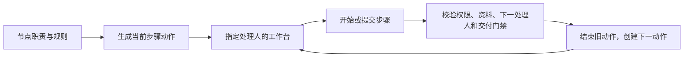

# 职责、流程步骤与个人工作台

2026-10-14。本文描述本次已实现的串行流程切片；完整产品目标及后续阶段见[研发全流程方案](../prd/tapd-alignment-and-orchestration.md)。本项目独立提供这些能力，不与 TAPD 同步。

## 人员与处理权

| 字段 | 含义 | 如何维护 |
| --- | --- | --- |
| `reporterId` | 提报业务问题的人 | 创建默认当前账号，可由有 `issue.assign` 权限的人调整 |
| `businessOwnerId` | 对业务结果负责，并协调缺失或失效的分派 | 创建默认当前账号，不能为空 |
| `developerId` | 最近一次分配的开发负责人 | 由开发任务认领、指派、转派和取消维护；事项内容接口不直接写入 |
| `qaOwnerId` | 测试验证职责 | 可以暂缺，进入使用此职责的步骤前必须明确 |
| `acceptanceOwnerId` | 业务验收职责 | 同上 |
| `watcherIds` | 关注事项的人 | 不授予操作权限，也不生成待办 |
| `processing.handlerId` | 当前流程步骤的处理人 | 从事项绑定的流程版本和职责解析，不能用开发负责人代替 |

系统权限与业务分派相互独立。管理员可以管理项目，但不会因此自动成为任何步骤的处理人或交付验证人。普通成员的部门上限、项目授权、账号状态仍在读写时校验。原创建人 `createdById` 是不可改写的审计身份，不等同于可调整的提报人。

## 流程驱动的交接

系统设置中的流程图支持节点的 `handler`（五种职责）、`category`（planning/work/development/verification）；连线支持 `requiredFields` 和 `requireAcceptedDelivery`，以及既有权限、原因必填和开发门禁。默认规划节点交给业务负责人，开发节点交给开发人，测试节点交给 QA，Bug 的关闭确认交给业务验收人。新节点省略职责时默认为业务负责人，省略类别时为一般处理。

每个事项最多一个未结束的 `WorkAction`，数据库部分唯一索引保护并发。步骤持有流程版本、节点、序号、处理人、类别、修订及开始/结束时间。事项修改、人员调整、步骤交接、历史写入在同一短事务内完成。重新进入同一节点生成新轮次；旧事项修订或旧动作修订不能操作新步骤。

`POST /api/projects/:id/issues/:issueId/step/start` 接收 `revision` 和 `actionRevision`，只允许当前处理人开始。重复提交同一已接受的开始不重复记录历史。处理资格要求 `issue.view`，以及当前节点至少一条出线配置的权限；进入下一节点、开始步骤及工作台采用同一规则。`category` 只决定栏目，不能推导操作权限。事项 DTO 的 `processing.startPermissions` 返回出线权限集合，前端据此显示开始入口。实际事项流转仍使用 `/transition`，只有节点处理人且具有所选连线的对应权限才能操作；进入下一节点前检查职责成员有效且有处理资格。发布版本不可变，后续发布不重绑在途事项。

取消开发任务会清空开发负责人，若流程仍处于开发节点，业务负责人收到“分派处理人”。处理人权限撤销时，工作台也将其显示为业务负责人的分派修复动作。有管理权限的人可在事项详情调整职责；私人开发任务的转派仍通过既有开发任务接口。

开发执行人失去 `session.start`、`issue.view` 或有效项目成员资格时，关联事项的业务负责人收到“处理开发分派”，需具有 `issue.view/issue.assign`；合并任务通知每个关联事项的业务负责人，每人的队列中同一任务只出现一次。独立任务由创建人协调。任务修复已经覆盖同一开发人步骤的分派异常时，不再重复显示事项修复。未启动任务通过既有转派接口重新指定有效执行人，清除修复待办；已启动任务仍不可转派，须协调恢复权限并核对原执行，遵守原有结束/取消门禁，不自动重启。

流程没有自动启动 Agent、合并代码或部署的能力。认领和分派只创建待开发任务，执行仍需执行人明确启动。系统全局需求/Bug 流程继续生效；项目独立流程方案、模拟器、事件自动化与并行会签属于后续阶段。

## 三栏与通知

`GET /api/workbench/actions` 接收 `bucket=todo|doing|verify`、`projectId`、`query`、`limit`、`offset`，返回 `items/total/nextOffset/counts`。`counts` 为相同项目及搜索范围内的三栏总数，不被当前 bucket 截断。首页与“查看全部”均调用此接口。

| 栏目 | 内容 |
| --- | --- |
| 待推进 | 本人未开始的步骤、本人待开发任务、阻塞的审批/问题、已结束执行待整理的成果、执行结果不明待核对、本人被退回的交付、明确交给业务负责人的分派修复 |
| 处理中 | 本人已开始的一般步骤，或本人实际 preparing/starting/running 的开发执行 |
| 待验证 | 本人被分派的测试/验收步骤与交付；已经开始验证的也留在这一栏 |

权限、项目/版本归档、开发任务结束状态都参与过滤。没有权限的人、关注人、仅提报事项的人不因这些关系产生个人动作。验收步骤与同一人的未完成交付验证重合时优先显示交付；发布交付不会隐藏其他人的规划步骤。开发类别步骤仅在步骤处理人与活跃开发任务执行人为同一人时合并展示为开发任务；不同人的步骤与任务各自保留。阻塞动作优先，其后按截止日期、优先级、创建时间稳定排序。

开发任务只向有权限的执行人暴露本人工作区/run key；分派修复只返回公开任务标题和任务入口，不返回私人工作区、run key、提示词、会话消息或代码，通知沿用同样边界。没有开发任务的本人会话审批按会话聚合，已结束开发任务的旧审批不会作为独立会话重新出现。结果未知时入口只引导核对原执行，不触发自动重试。

`GET /api/workbench/attention` 直接使用同一动作快照，只提醒待推进与待验证的动作；审批/问题按所属任务或会话聚合。首次打开不补发通知、账号切换重置基线、失败快照不重置去重记录。事项、开发、交付的原资源列表继续用于浏览与跟踪，不作为首页三栏的数据定义。独立的“等待他人/关注/可认领”动作视图尚未实现。

## 交付验证与返工

- 发布必须有 `reviewerId`；省略时仅可采用事项明确配置的 QA/验收人，不能默认作者或所有有验收权限的人。`GET /api/projects/:id/reviewers` 返回当前有效且具备 `deliverable.review` 的候选人。各发布入口要求明确选择验证人。
- `/deliveries/:id/start` 记录验证开始；开始后仍属待验证。`/review` 仅允许指定验证人，通过要求全部核对项，退回要求原因，均检查修订号和当前权限。
- `/review` 可携带 `transitionId/issueRevision`，在同一事务应用事项节点的职责、权限、必填资料及交付门禁。结论与目标不能冲突；流转失败时验收记录也回滚。
- 退回后原发布人获得“修改并重新提交”。新发布携带 `supersedesId/previousRevision`，来源不变；只有原发布人可重提，唯一约束防止两个后继。原交付和验收意见保留，下一修订重新生成清单和待验证动作。
- `/deliveries/:id/assign` 接收 `revision/reviewerId`，具有 `issue.assign` 和协作权限的人可调整 pending 交付的验证人；重置本轮开始时间，旧验证人不可操作。验证人撤权时，关联事项的业务负责人（独立交付则为作者）获得分派修复动作。
- `requireAcceptedDelivery` 检查最新交付的结论；旧交付通过不能满足新的 pending/returned 交付。版本归档同时拦截未验证及尚未重提的退回交付。

## 数据部署边界

`20261014200000_workflow_responsibilities` 新增角色、步骤、交付验证人和返工链；移除旧人员字段。按用户要求不做历史业务数据转换。迁移遇到已有事项、交付或修改过的系统流程时明确失败并回滚，要求以新库部署；不会自动清表，也不会移动或删除 Git、Worktree、session/source 数据。

本次仅在隔离测试数据库验证迁移及行为，不部署到现有业务数据库。验证入口见根 AGENTS 和[验收记录](../reviews/workflow-actions-2026-10-14.md)。
