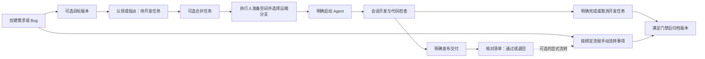
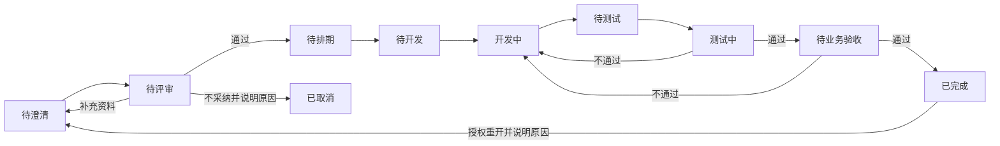
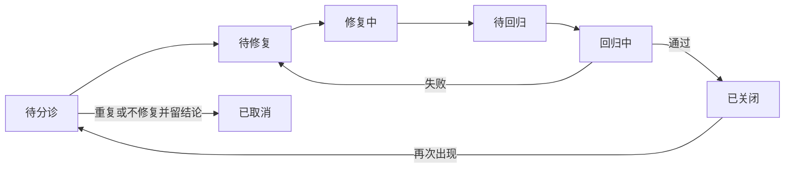

# 研发全流程与 TAPD 能力对齐方案

日期：2026-10-14。状态：目标设计，首个职责与工作台切片已实施。重构前代码核对基线：`0ca4a98`。实际完成范围见[实施记录](../reviews/workflow-actions-2026-10-14.md)，当前行为以[流程动作契约](../engineering/workflow-actions.md)为准。

用户已明确：本项目独立具备类似 TAPD 的能力，不做 TAPD 数据同步；允许整个流程重构，不要求兼容历史业务数据。工作台队列、人员职责和流程编排必须一起定义。本文件与[工作台和职责规则](./workbench-action-contract.md)共同描述目标；现有工程契约仍描述当前实现，实施时须同步替换。

## 1. 结论与范围

当前项目已经串起“事项 → 开发任务 → Agent 会话 → 交付验收”，并有需求和 Bug 的可视化状态机。要达到本次要求，需要补齐三部分：

1. 完整业务链：需求评审、任务拆分、迭代、测试、业务验收、版本发布及反馈。
2. 可执行流程规则：每一步由谁处理、提交什么、满足什么条件才能交接、交接后产生什么待办。
3. 工作台：按当前用户承担的动作组织工作，而不是直接将需求、开发任务、交付三张列表改成三个栏目。

TAPD 官方目前区分状态机、流程节点、自动化协作与 DevOps 交付流水线。目标也分别建模，避免把所有含义塞进一张状态图。下文流程和字段是本项目的设计建议，并非声称 TAPD 使用完全相同的实现或所有版本都包含相同功能。

本文定义完整产品目标，首轮实施已交付职责、个人动作队列和串行交接基础；尚未完成的目标不视为已上线能力。不处理实际业务数据、执行真实需求或改动现有 worktree。

## 2. 重构前能力基线

| 环节 | 当前实现 | 与目标的差距 | 主要证据 |
| --- | --- | --- | --- |
| 项目与成员 | 部门权限上限、项目授权；管理员拥有项目权限，私人空间仍校验所有者 | 没有产品、测试、验收等流程职责的明确绑定 | [权限规则](../../src/domain/project-permissions.cjs) |
| 需求/Bug | 图文、优先级、严重程度、验收标准/复现信息、截止日期、标签、版本、评论、附件、历史 | 无父子需求、结构化关联、迭代、自定义字段；`participantIds` 不表达具体职责 | [事项规则](../../src/domain/project-issues.cjs)、[模型](../../prisma/schema.prisma) |
| 流程编排 | 系统管理员维护需求/Bug 两套图；状态、连线、可开发节点、两类流转权限、原因必填；草稿与不可变发布版本 | 无处理人规则、节点表单、业务条件、节点任务、自动化动作、实例执行记录 | [流程规则](../../src/domain/issue-workflows.cjs)、[编辑器](../../web/src/features/settings/SystemWorkflows.vue) |
| 开发分配 | 每条事项认领/指派为待开发任务；同执行人、同项目、同版本可合并；事项只允许一个活跃开发认领 | 业务子任务与 Agent 执行任务尚未分开，难以表达同需求前后端并行分工 | [开发服务](../../src/application/project-development-services.cjs) |
| 开发执行 | 显式启动、实时远端分支、独立 worktree、会话、审批、续聊、结束；另有独立开发入口 | 缺少与业务步骤的受控联动；Agent 结束后仍需人工决定后续 | [开发服务](../../src/application/project-development-services.cjs)、[开发重构](./development-refactor.md) |
| 交付 | 项目级交付；可关联事项/本人开发任务，独立开发可直接交付；保存说明、提交文本、验收清单；通过/退回 | 缺少指定验证人、交付修订链、测试证据与完整质量门禁；提交文本不等同于已核验的 Git/CI 证据 | [交付服务](../../src/application/project-content-services.cjs)、[验收规则](../../src/domain/deliverable-review.cjs) |
| 版本 | 版本号、目标日期、范围、按事项统计进度、归档/恢复 | 只有 `active/archived`；无独立迭代、候选版本、上线审批、部署和回滚记录 | [版本存储](../../src/storage/project-lifecycle-store.cjs) |
| 工作台 | “待推进”取与我相关的未终结事项；“处理中”取本人未结束开发任务；“待验证”取可见项目的 pending 交付 | 相关不等于负责，未结束不等于处理中，可见不等于待我验证；详见配套文档 | [工作台存储](../../src/storage/workbench-store.cjs)、[首页](../../web/src/features/projects/WorkbenchHome.vue) |
| 待处理提醒 | 本人 Agent 审批/问题、有验收权限项目的待验收交付 | 交付仍未指定处理人；首页与通知查询口径不同 | [提醒服务](../../src/application/attention-services.cjs) |
| 周边协作 | 项目资产、文件、评论、历史、跨项目检索、MCP 图文发布与指派 | 可继续支撑业务，但尚不是知识库、测试平台或自动化引擎 | [工程索引](../engineering/index.md) |

### 2.1 现有流程怎样运行

上图是业务动作关联，不表示发布交付必然发生在任务完成之前。当前发布交付、完成任务、事项流转是独立操作，允许只发布事项交付而不引用开发任务。

- 默认需求：规划中 → 开发中 → 待验证 → 验证中 → 已实现；支持拒绝、退回和重开。
- 默认 Bug：待处理 → 处理中 → 已解决待验证 → 已验证待关闭 → 已关闭；支持失败待处理、取消和重开。
- 开发任务：`planned`、`unknown`、`started`、`completed`、`cancelled`、`merged`。`unknown` 表示已受理但派发结果待确认，不能当成尚未启动而再次派发。
- 交付：`pending → accepted/returned`；通过必须勾选全部核对项，退回必填原因。
- 版本：`active ↔ archived`；归档检查事项终态及开发任务结束。

当前已可使用的编排入口是“系统设置 → 流程编排”：修改需求/Bug 节点与连线，保存并校验发布；新事项绑定新版本，在途事项保留原版本。项目成员在事项详情执行有权限的流转。当前画布不能配置下文的人员分派或自动动作。

### 2.2 需要一起重构的衔接点

| 场景 | 当前代码行为 | 目标规则 |
| --- | --- | --- |
| 开发已经开始，事项仍在规划中 | 开发服务不自动流转业务状态 | 可配置“真实开始事件 → 开发中”；必须通过绑定版本的合法流转，不按中文状态名匹配 |
| 交付退回时选择事项完成流转 | 验收结论和可选流转分别校验，尚未绑定二者语义 | 模板明确通过/退回各自允许的目标；冲突组合拒绝 |
| 事项已终结、任务已完成，但还有 pending 交付 | 版本归档未检查交付队列 | 归档检查未结验证、发布操作和异常记录；被替代交付明确终结 |
| 一个需求要前后端并行开发 | 单事项唯一活跃认领限制并行拆分 | 先拆业务子任务，再约束每个子任务只能有一个活跃执行占用 |
| 本轮 Agent 正常结束 | 不代表开发任务完成、事项验收或发布成功 | 产生“整理成果/继续开发”动作，由执行人决定 |
| 需求或 Bug 换了当前处理环节 | 当前负责人主要跟随开发认领 | 业务负责人稳定，当前处理人随流程变化；二者分开 |

这些结论来自静态代码核对，未对生产数据复现，不是完整缺陷扫描。

## 3. 目标业务对象

| 对象 | 回答的问题 | 关联与边界 |
| --- | --- | --- |
| 需求 | 要实现什么价值，按什么标准接受？ | 可有父子层级、阻塞关系；关联迭代、目标版本、Bug、测试和交付 |
| Bug | 哪里不符合预期，如何复现和验证修复？ | 关联需求/测试执行、发现版本、修复目标版本；保留解决结论 |
| 业务子任务 `WorkTask` | 谁完成哪一部分工作？ | 需求/Bug 可拆多项，支持前端、后端、设计、测试准备等；可人工完成或使用 Agent |
| 开发执行任务 `DevelopmentTask` | 哪次开发执行处理哪些子任务？ | 执行人唯一；允许明确合并同项目、同迭代、同目标版本的本人子任务；每个子任务最多一个活跃执行占用 |
| Agent 轮次/会话 | 工具现在执行到哪里？ | 原生运行、审批、问题、失败、取消，不承载业务验收状态 |
| 交付 `Delivery` | 这次提交了什么可验证成果？ | 有公开范围、来源子任务、事项范围、证据、修订、验证/验收结果；私人会话不自动公开 |
| 迭代 `Iteration` | 这个时间段承诺完成什么？ | 目标、开始/结束日期、范围、容量；结束未完成项明确结转，不伪造完成 |
| 发布版本 `Release` | 哪批成果准备在什么时候交付给用户？ | 汇总可跨迭代成果；记录候选版本、发布门禁、上线和回滚；归档是独立管理属性 |
| 测试用例/计划/执行 | 用什么方式证明结果符合预期？ | 用例可复用；计划确定范围；每次执行绑定实际版本与结果，失败可生成关联 Bug |
| 流程实例/处理动作 | 现在该谁做什么，做完交给谁？ | 绑定不可变流程版本，生成个人待办，记录交接、退回、超时和自动化结果 |

需求、子任务、执行、交付、测试和发布分别保存状态。同一个需求允许多个子任务和多轮交付；“全部开发完成”只满足进入验证的条件，“测试通过”也不自动代表正式上线。

独立开发保留：不强制制造需求/Bug；可以直接提交独立交付。进入正式发布前必须有明确验收人和可追溯的成果范围。

## 4. 人员字段与职责

取消语义不明确的通用“参与人”和不带前缀的“负责人”。界面及接口都区分以下概念：

| 字段/关系 | 含义 | 是否直接产生个人待办 |
| --- | --- | --- |
| 创建人 `createdBy` | 谁在系统建立记录；审计事实，不可编辑 | 否 |
| 提报人 `reporterId` | 谁提出需求/报告问题；默认创建人，代录需明确记录 | 仅当流程把“补充资料”交给提报人时 |
| 业务负责人 `businessOwnerId` | 对事项价值、范围、最终结果负责；需求通常产品负责人，Bug 通常分诊/质量负责人 | 不因这个字段一直挂待办；具体动作分派到本人时才产生 |
| 当前处理人 | 当前流程步骤的实际受理者，由处理动作保存；并行步骤可有多人 | 是，按动作类别进入工作台 |
| 开发执行人 `executorId` | 某个开发执行任务的唯一执行者，拥有私人会话和代码上下文 | 产生开发动作；不承担默认测试/验收责任 |
| 测试负责人 `qaOwnerId` | 组织测试、回归及 Bug 验证的默认责任人 | 到测试步骤才产生验证动作 |
| 业务验收人 `acceptanceOwnerId` | 判断业务目标是否达成的人，可与测试负责人不同 | 到业务验收步骤才产生验证动作 |
| 发布负责人 | 对指定版本的发布准备、执行及回滚协调负责 | 到相应发布步骤才产生动作 |
| 关注人 `watcherIds` | 订阅允许查看的业务动态 | 否，不获得处理、验收或会话权限 |
| 候选处理人/候选组 | 可从共享池认领某步骤的人 | 进入“可认领”，认领后才进入个人三栏 |

同一成员可以承担多种职责，不按部门名称推断职责，也不需要切换“产品/研发”界面。职责绑定不自动授予权限；执行动作须同时满足当前分派、项目权限、字段/流转权限及归档门禁。管理员管理权限不意味着承担所有项目的待办。

项目设置维护业务、分诊、测试、验收、发布的默认责任人/候选组。创建事项时显式继承并展示，可在授权范围内调整。未能确定下一处理人时，形成分派异常并交给明确的项目流程协调人；不把待办广播给全部成员或全部管理员。验收人为空时不能提交验收。

关注人只订阅，实际协作必须落到子任务或步骤分派。现有 `participantIds`、开发驱动的 `assigneeId` 不作为新语义的兼容别名，也不自动猜测历史字段对应哪种职责。

### 4.1 字段在哪一步确定

| 信息 | 确定时点与维护人 | 约束 |
| --- | --- | --- |
| 提报人、业务负责人 | 创建事项时；提报人默认创建人，业务负责人由项目默认值或有权分派者选择 | 提交正式事项时均必填；不接受任意项目外用户；创建人审计字段不随代录或交接改变 |
| 当前处理人 | 进入每个步骤时按发布规则解析 | 与步骤交接同一事务确定；流程协调人接收无法分派的异常，不能让对象无声停滞 |
| 测试负责人、业务验收人 | 创建时可选；提交对应验证步骤前补齐，由有权分派者维护 | 测试/验收前必须解析到合格成员；调整只影响尚未完成的分派，保留旧记录 |
| 开发执行人 | 子任务规划及启动时确定 | 启动后的执行身份不可直接转派；先确认原执行结束，再重新规划后续任务 |
| 迭代与目标版本 | 排期时由计划负责人确认 | 可在需求池留空；进迭代后范围调整留痕；不把迭代名称当成版本号 |
| 优先级与严重程度 | 业务负责人排序，Bug 分诊确认严重程度 | 优先级用于顺序，严重程度用于影响/发布门禁；不能相互覆盖 |
| 验收标准 | 需求评审前由业务负责人完善，评审确认 | 交付时冻结当次标准；标准变更形成修订并重新判断受影响的验证 |
| 截止时间 | 事项计划和步骤时限分别维护 | 事项截止不等于所有步骤截止；工作台展示当前动作时限，并可查看事项期限 |
| 关联关系 | 拆分、分诊或测试发现问题时创建 | 明确区分父子、阻塞、重复、关联需求、关联测试执行，不能仅用标签代替 |
| 关注人 | 本人关注或经允许添加订阅 | 不授予数据访问权；用户可取消订阅，离开项目后停止投递 |

“需求状态/Bug 状态”来自对象状态机，“处理步骤”来自流程实例，“执行状态”来自 Agent，“验证结果”来自验证记录，详情同时呈现时必须标明对象，不能统称为进度。

## 5. 建议内置流程

以下是可发布的默认模板，节点名称可调整，阶段语义和规则使用稳定标识。完整步骤的启用由项目选定模板决定，紧急修复可采用较短模板，但仍须保留验证与发布证据。

### 5.1 需求流程

- 提交评审：描述、价值/范围、验收标准齐全，指定评审人；评审不等于测试验证。
- 排期：确认优先级、工作量、依赖、迭代及目标版本；大需求先拆子需求/子任务。
- 提测：必需子任务完成、交付证据可读、验证责任人明确；测试可按交付批次进行。
- 完成：必需测试及业务验收通过，范围内阻塞 Bug 已处理。取消、延期、剔除范围均留原因。
- “已完成”表示需求验收完成；是否上线从发布记录读取，不再追加一个混合开发/部署含义的状态。

### 5.2 Bug 流程

Bug 增加独立的解决结论：已修复、重复、非缺陷、无法复现、不予修复。重复必须关联原 Bug；无法复现必须记录环境与检查结果；不予修复必须说明理由并按模板批准。结论不替代状态。延期保留为未完成事项并调整计划，不以“关闭”掩盖。

必需字段按步骤配置：分诊时确认复现信息、预期/实际结果、严重程度和发现环境；修复提交时确认修复版本与证据；回归时保存验证结果。严重程度表示影响，优先级表示处理顺序，二者分开。

### 5.3 开发、交付与返工

1. 子任务明确范围与处理人；使用 Agent 时先规划开发执行任务，再由执行人明确启动。认领、排期、自动分派均不启动 Agent。
2. 真实运行事件更新执行状态；模板可据此推进对应业务开发步骤。单个子任务开始不能把所有关联需求都自动推进，须逐对象检查条件。
3. 本轮结束后给执行人产生“整理成果”动作，可以继续开发、提交交付、或结束个人开发。单纯正常退出不产生验收成功。
4. 提交交付时冻结来源范围、验收标准、变更说明、代码/构建引用和测试说明，指定验证人。多事项交付逐项记录结果，不用一个勾选通过所有事项。
5. 测试和业务验收可串行，也可按明确模板分支；只有必需分支全部通过才能完成交付。
6. 退回交付保留原结论，产生返工动作；新交付修订通过 `supersedesId` 关联原修订。旧修订不覆盖、不继续留在待验证队列。
7. 发布交付不自动推送、合并或上线。代码评审、CI、业务验收与部署分别提供事实和门禁。

### 5.4 迭代与发布

| 流程 | 推荐阶段 | 关键门禁 |
| --- | --- | --- |
| 迭代 | 规划中 → 进行中 → 复盘中 → 已结束 | 开始冻结承诺范围；增减记录变更；结束时处理未完成项和结转；统计不把结转计为完成 |
| 发布 | 计划中 → 集成验证 → 待发布审批 → 待上线 → 上线中 → 已上线 | 需求/交付验收、阻塞 Bug、候选提交/制品、测试结果、回滚方案及责任人完整 |
| 发布异常 | 发布失败 → 修复/重新审批；已上线 → 回滚中 → 已回滚 | 每次尝试独立记录；外部结果不明先核验，不能自动宣称上线或重复部署 |
| 归档 | 独立于业务阶段的归档/恢复 | 无未结必需动作、pending 验证和在途执行；恢复归档不恢复部署或 Agent |

近期可先记录人工发布证据及审批；后续接入 CI/CD 后由适配器核验。手工记录必须明确标注来源，不把它展示为自动验证过的流水线结果。

## 6. 流程编排能力

### 6.1 分成三层

| 层 | 编排什么 | 示例 |
| --- | --- | --- |
| 对象状态机 | 一个对象有哪些状态、允许如何流转 | Bug 修复中 → 待回归；退回原因必填 |
| 处理流程 | 每一步谁处理，是否串行/并行，如何交接 | QA 回归与业务验收分别产生动作，按规则汇合 |
| 自动化规则 | 事件发生且条件满足后执行什么受控动作 | 交付提交后分派验证、超时提醒、CI 结果更新证据 |

开发执行任务和 Agent 的真实状态由程序协议管理，不开放任意改名或任意跳转。它们作为流程事件来源及受控动作目标，不能通过画布把失败改成成功。

### 6.2 节点、连线与规则属性

| 配置 | 必需内容 |
| --- | --- |
| 状态节点 | 稳定 ID、名称、初始/普通/完成/取消、业务阶段、允许的开发操作 |
| 人工步骤 | 动作类型、处理人来源、候选组/认领模式、输入表单、截止规则、完成条件、工作台语义 |
| 流转连线 | 来源/目标、动作名称、所需权限、处理人约束、字段必填/只读、原因要求、条件、下一处理人 |
| 条件分支 | 有类型的字段与运算符、分支优先级、默认分支；拒绝无法确定去向的发布 |
| 并行与汇合 | 分支集合、全部通过/任一通过、拒绝后的处理方式、未完成分支取消规则 |
| 自动动作 | 注册的动作类型、参数映射、执行身份、幂等键、超时与失败处理；不执行任意用户脚本 |
| 事件等待 | 对象、事件类型、实例轮次/关联标识、超时动作；迟到或旧轮事件不得完成新步骤 |
| 工作台设置 | 步骤分类及处理方式，自动推导栏目；不能任意把已完成或别人的动作放进我的待办 |

状态流转条件、必填字段和分派在服务端统一执行。UI 展示“谁可以操作、缺什么、下一步交给谁”；禁止仅隐藏按钮而绕过后端校验。

首批自动动作：创建/分派处理动作、修改获准业务字段、受控事项流转、产生应用内通知。合并、发布、Agent 启动等外部副作用先形成待确认动作，保留明确的人类操作入口。后续如要全自动执行，须另行设计可审计的授权策略。

### 6.3 模板治理与运行

目标采用“系统模板库 + 项目流程方案”。系统管理员维护可复用模板，具备项目流程管理权限的成员可复制成项目草稿、调整并发布；项目将需求、Bug、交付、迭代、发布绑定到明确版本。该设计会替换当前只允许系统管理员维护两套全局流程的限制，实施时同步权限目录与工程契约。

- 草稿可编辑，发布版不可变；保存与发布均做修订号检查。
- 新实例绑定项目当时选定的发布版；在途实例不因模板更新变更。这是在新系统内保护运行一致性，不是兼容旧业务数据。
- 发布前检查可达性、可结束性、处理人解析、字段合法性、分支覆盖、并行汇合、动作授权和自动循环。
- 提供模拟运行：输入虚构对象、成员及事件，看到流转、字段要求、分派和工作台结果，不执行真实副作用。
- 实例记录每一步的输入快照、操作人、规则版本、结果、耗时、失败及补救动作；需要人工处理的失败进入明确责任人的待办。

例：Bug“提交修复”应在一个业务提交中校验修复说明和交付证据、更新 Bug 状态、结束开发步骤、创建 QA 验证动作并记录事件。通知发送失败不会撤销已完成交接；通知独立重试，不重复生成验证动作。

## 7. 目标数据与工程边界

模型按职责分开：`Issue`、`IssueRelation`、`WorkTask`、`DevelopmentTask`、`TaskExecutionLink`、`Iteration`、`Release`、`ReleaseAttempt`、`DeliveryRevision`、`DeliveryScope`、`VerificationRecord`、`TestCase`、`TestPlan`、`TestExecution`、`WorkflowDefinition`、`WorkflowVersion`、`ProjectWorkflowBinding`、`WorkflowInstance`、`StepInstance`、`WorkAction`、`AutomationRule`、`AutomationRun`、`OutboxEvent`。这是目标概念清单，不要求用大范围通用 JSON 代替关系约束。

关键规则：

- 事项保存提报人、业务负责人、测试/验收默认责任人和关注关系；当前处理人来自未结束步骤，不再复用开发执行人字段。
- 所有关联校验同项目、对象类型与当前可访问范围；父子/阻塞关系防止非法环；每个业务子任务的活跃开发占用唯一。
- 业务变更、步骤交接、处理动作和 outbox 在短数据库事务中一起提交；Git、Agent、CI、通知等等待在事务外。
- 消费事件用事件 ID、实例 ID、步骤轮次和动作键去重；多进程领取有租约/冲突控制。外部副作用先记录意图，结果不明先对账，不自动重放。
- 并行退回会结束本轮无效分支并开新轮；旧审批、旧 CI 回调和旧交付不能推动新轮。
- 自动化使用显式执行身份和允许的能力；执行时重验项目、对象和人员权限，不能把系统管理员身份当作隐式运行身份。
- 工作台聚合与动作详情使用相同授权及规则结果；不向他人暴露私人会话、代码、提示词或凭据。

| 位置 | 职责 |
| --- | --- |
| `src/domain/` | 状态图、条件表达式、人员分派规则、字段规则、工作台分类等纯规则 |
| `src/application/` | 流程用例、步骤交接、当前授权、自动化协调、发布门禁、公开 presenter |
| `src/storage/` 与 `prisma/` | 模型、事务、唯一约束、修订、outbox、运行记录和索引 |
| `src/execution/`、`src/agents/`、`src/git/` | 保留通用执行/协议/仓库职责，通过应用层事件衔接业务 |
| `src/http/` | 路由、鉴权、输入输出适配；复用同一服务覆盖 Web 和开放接口 |
| `web/src/features/` | 流程编辑、事项、计划、验证、工作台页面；跨功能由 app 组合 |

不维护旧 API、旧人员字段或旧业务表的兼容分支；以新模型建立安装基线。实际部署的新库/重建动作另行执行，不因“不兼容历史数据”自动清除数据库或工作目录。现有私人会话、仓库及 worktree 文件保持原位。

## 8. 页面组织

沿用工作台、项目、事项、开发、交付的主导航和项目中性视觉，项目内增加迭代、测试、发布和流程设置入口，不按职业建立多套导航。

- 事项详情：正文及验收标准、明确命名的人员职责、下一步动作、关联子任务/测试/交付、历史；不再出现无定义的“参与人”。
- 流程设计器：左侧节点/动作，中央图，右侧属性；提供规则校验、模拟、版本差异及发布。手机保留查看和属性编辑，画布局部滚动。
- 流程运行页：当前步骤、处理人、等待原因、预计时间和历史；有权限者处理分派失败、退回和超时。
- 交付详情：来源范围、证据、QA 结果、业务验收、下一处理人、返工链；验证动作明确指定到人。
- 工作台：个人动作三栏及独立的等待/关注/可认领入口；具体定义见[工作台规则](./workbench-action-contract.md)。

正式 UI 继续复用 AppSelect、ModalDialog、统一反馈、国际化和响应式 tokens。执行失败保留草稿；缺权限和无数据分别解释。代码变更按 Jenkins 运行浏览器与七种 CSS 视口检查。

## 9. 实施顺序与完成标准

| 阶段 | 必须交付 | 验收结果 |
| --- | --- | --- |
| P0：职责与工作台 | 新人员模型、步骤分派、WorkAction、三栏统一查询、详情动作与通知统一；删除模糊字段 | 同一事项对不同用户只出现各自应处理动作；待开发不算处理中；作者不自动成为验收人；首页与全部列表一致 |
| P1：流程闭环 | 模板/项目绑定、状态机增强、表单/条件/权限、串行步骤、交付返工、受控自动化、模拟与日志 | 无需改代码即可配置“修复提交 → 指定 QA → 通过关闭/失败返工”；重复提交不重复交接 |
| P2：计划与质量 | 父子需求、业务子任务与执行分离、迭代、测试用例/计划/执行、发布门禁及人工发布记录 | 一条需求可多人并行拆分，测试失败形成关联 Bug；迭代和版本有独立范围与结果 |
| P3：复杂编排与集成 | 并行会签/分支汇合、定时规则、CI/代码评审证据、部署适配、指标报表 | 重启可恢复流程；重复/乱序回调不重复执行；发布失败/回滚可追踪 |

P0/P1 是优先开发的完整纵向切片，但不应宣称其已全面对齐 TAPD。自定义工作项类型、完整自定义字段/布局、甘特图/资源管理、工时、知识库、插件生态列入后续扩展，分别验收，不混入第一阶段完成率。

必须覆盖：越权与撤权、流程版本冻结、并发认领、修订冲突、交付通过/退回与流转匹配、空责任人、旧轮事件、幂等、副作用结果未知、归档门禁、私人会话隔离，以及配套文档中的逐用户工作台场景。

代码实施运行 AGENTS.md 的 lint、架构/单元/集成、build 与 Jenkins 浏览器检查；测试只使用隔离 PostgreSQL、临时 Git、fake Agent 和模拟 CI。本轮已进入代码实施，实际完成范围及当次验证见[实施记录](../reviews/workflow-actions-2026-10-14.md)，不以历史验收代替。

## 10. TAPD 对照与公开依据

以下官方页面于 2026-10-14 读取；只用于核实公开能力范围，未登录企业实例核对套餐或全部配置细节。

| 公开能力 | 本项目现状 | 本方案位置 |
| --- | --- | --- |
| 自定义工作项属性、结构、表单及字段 | 固定需求/Bug、固定字段 | 先定义清楚字段与关系；通用自定义模型后续扩展 |
| 状态机与流程节点双引擎 | 需求/Bug 状态机 | 第 6 节处理流程与状态机分离 |
| 自动化协作 | 局部业务动作和提醒，无通用规则引擎 | P1 基础自动化、P3 定时及复杂分支 |
| 需求拆分、迭代及发布规划 | 事项、发布版本和开发任务 | 第 3、5 节与 P2 |
| 测试用例、测试计划、测试执行 | 交付核对清单 | P2 独立测试管理 |
| DevOps 集成及交付流水线 | Agent/worktree/代码查看，缺少发布流水线 | P3；保留本项目 Agent 开发特色 |
| 故事墙、燃尽图、统计报告 | 列表及基础版本进度 | 新事件/迭代模型稳定后补齐，不凭当前状态猜历史指标 |

来源：[TAPD 项目协作](https://www.tapd.cn/official/project_collaboration_index)、[研发全流程](https://www.tapd.cn/official/solutions/entire)、[需求管理](https://www.tapd.cn/official/solutions/demand)、[敏捷项目管理](https://www.tapd.cn/official/solutions/agile)。
