# B 方案页面与原型映射

日期：2026-10-13。48 张设计图对应 46 个桌面页面／关键状态及 2 个移动布局示例；移动端由同一 HTML 响应式重排，不是独立产品。

[返回 PRD](ui-refactor.md) · [打开原型](../prototypes/ui-refactor/review.html) · [完整参考图册](assets/ui-refactor/index.html)

## 01 · 工作入口与项目

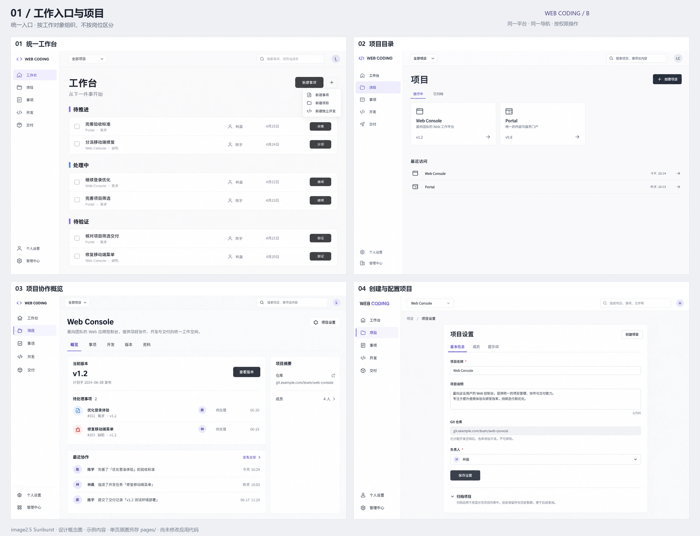

| 编号 | 界面 | 原型入口 | 参考图 |
| --- | --- | --- | --- |
| 01.1 | 统一工作台 | [查看](../prototypes/ui-refactor/review.html#home) | [原始尺寸](assets/ui-refactor/pages/01-home.webp) |
| 01.2 | 项目目录 | [查看](../prototypes/ui-refactor/review.html#projects) | [原始尺寸](assets/ui-refactor/pages/01-projects.webp) |
| 01.3 | 项目协作概览 | [查看](../prototypes/ui-refactor/review.html#project) | [原始尺寸](assets/ui-refactor/pages/01-project-overview.webp) |
| 01.4 | 创建与配置项目 | [查看](../prototypes/ui-refactor/review.html#project-settings) | [原始尺寸](assets/ui-refactor/pages/01-project-config.webp) |

## 02 · 事项表达与协作

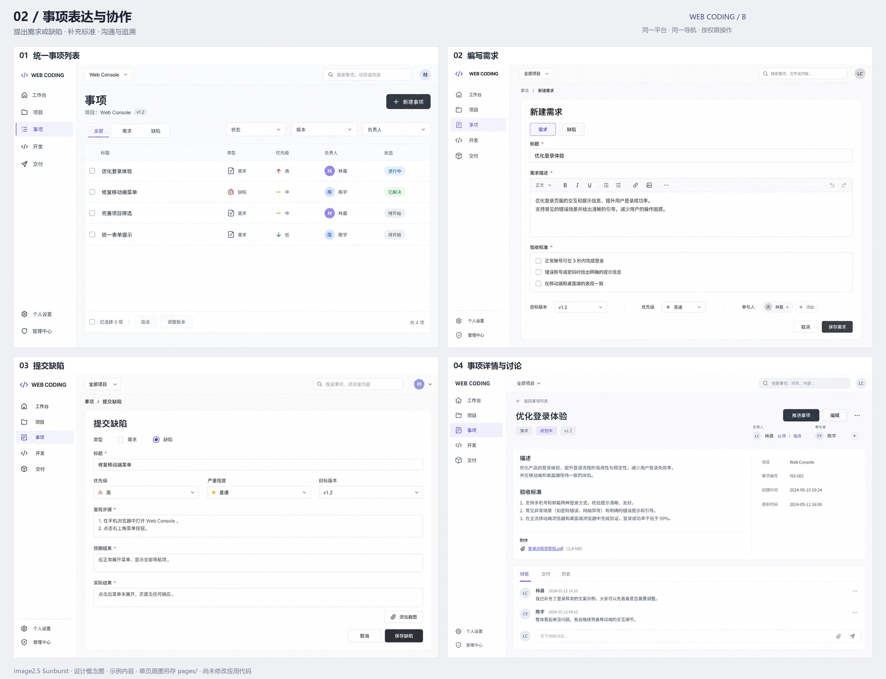

| 编号 | 界面 | 原型入口 | 参考图 |
| --- | --- | --- | --- |
| 02.1 | 统一事项列表 | [查看](../prototypes/ui-refactor/review.html#issues) | [原始尺寸](assets/ui-refactor/pages/02-issues.webp) |
| 02.2 | 编写需求 | [查看](../prototypes/ui-refactor/review.html#issue-new) | [原始尺寸](assets/ui-refactor/pages/02-requirement-editor.webp) |
| 02.3 | 提交缺陷 | [查看](../prototypes/ui-refactor/review.html#bug-new) | [原始尺寸](assets/ui-refactor/pages/02-bug-editor.webp) |
| 02.4 | 事项详情与讨论 | [查看](../prototypes/ui-refactor/review.html#issue) | [原始尺寸](assets/ui-refactor/pages/02-issue-detail.webp) |

## 03 · 版本规划与分派

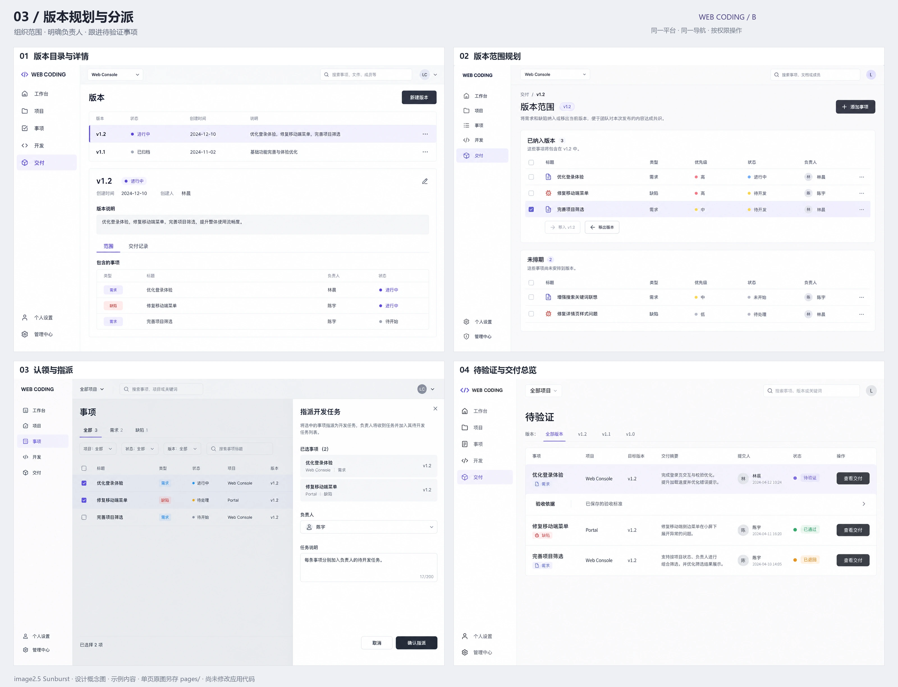

| 编号 | 界面 | 原型入口 | 参考图 |
| --- | --- | --- | --- |
| 03.1 | 版本目录与详情 | [查看](../prototypes/ui-refactor/review.html#releases) | [原始尺寸](assets/ui-refactor/pages/03-releases.webp) |
| 03.2 | 版本范围规划 | [查看](../prototypes/ui-refactor/review.html#release) | [原始尺寸](assets/ui-refactor/pages/03-release-scope.webp) |
| 03.3 | 认领与指派 | [查看](../prototypes/ui-refactor/review.html#assignment) | [原始尺寸](assets/ui-refactor/pages/03-assignment.webp) |
| 03.4 | 待验证与交付总览 | [查看](../prototypes/ui-refactor/review.html#deliveries) | [原始尺寸](assets/ui-refactor/pages/03-acceptance-queue.webp) |

## 04 · 开发任务与准备

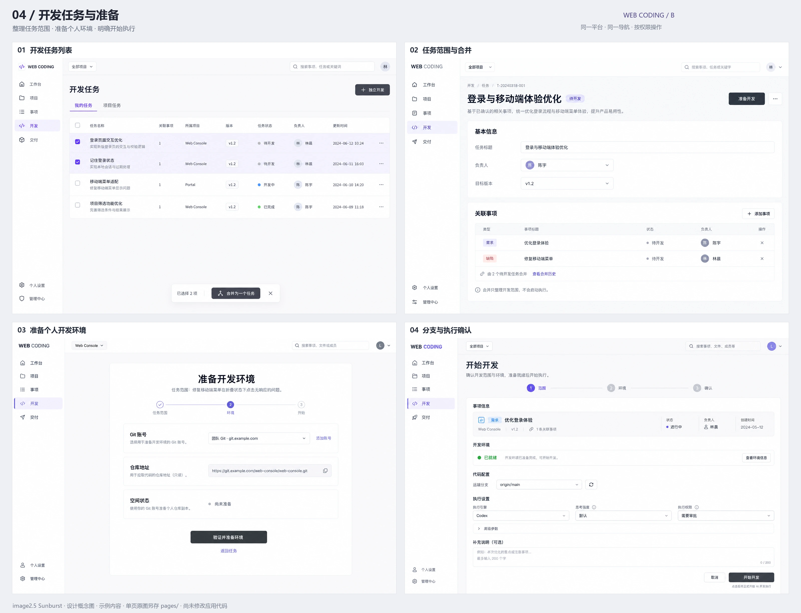

| 编号 | 界面 | 原型入口 | 参考图 |
| --- | --- | --- | --- |
| 04.1 | 开发任务列表 | [查看](../prototypes/ui-refactor/review.html#tasks) | [原始尺寸](assets/ui-refactor/pages/04-development-tasks.webp) |
| 04.2 | 任务范围与合并 | [查看](../prototypes/ui-refactor/review.html#task) | [原始尺寸](assets/ui-refactor/pages/04-task-detail.webp) |
| 04.3 | 准备个人开发环境 | [查看](../prototypes/ui-refactor/review.html#prepare) | [原始尺寸](assets/ui-refactor/pages/04-environment-prepare.webp) |
| 04.4 | 分支与执行确认 | [查看](../prototypes/ui-refactor/review.html#start) | [原始尺寸](assets/ui-refactor/pages/04-start-wizard.webp) |

## 05 · AI 会话与代码

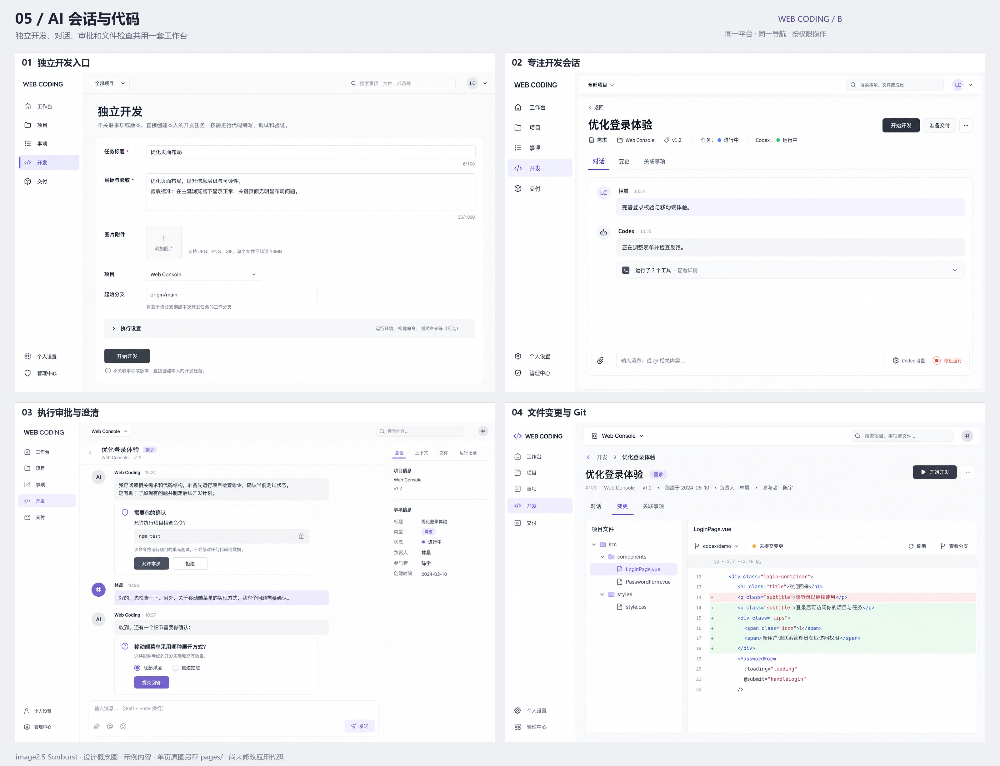

| 编号 | 界面 | 原型入口 | 参考图 |
| --- | --- | --- | --- |
| 05.1 | 独立开发入口 | [查看](../prototypes/ui-refactor/review.html#manual) | [原始尺寸](assets/ui-refactor/pages/05-manual-start.webp) |
| 05.2 | 专注开发会话 | [查看](../prototypes/ui-refactor/review.html#session) | [原始尺寸](assets/ui-refactor/pages/05-session.webp) |
| 05.3 | 执行审批与澄清 | [查看](../prototypes/ui-refactor/review.html#approval) | [原始尺寸](assets/ui-refactor/pages/05-approval-question.webp) |
| 05.4 | 文件变更与 Git | [查看](../prototypes/ui-refactor/review.html#changes) | [原始尺寸](assets/ui-refactor/pages/05-code-inspector.webp) |

## 06 · 交付、验证与历史

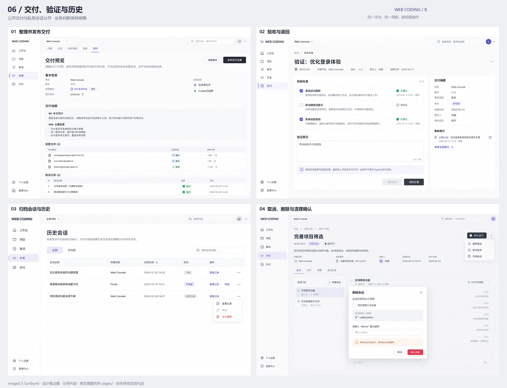

| 编号 | 界面 | 原型入口 | 参考图 |
| --- | --- | --- | --- |
| 06.1 | 整理并发布交付 | [查看](../prototypes/ui-refactor/review.html#publish) | [原始尺寸](assets/ui-refactor/pages/06-publish-delivery.webp) |
| 06.2 | 验收与退回 | [查看](../prototypes/ui-refactor/review.html#delivery) | [原始尺寸](assets/ui-refactor/pages/06-verify-detail.webp) |
| 06.3 | 归档会话与历史 | [查看](../prototypes/ui-refactor/review.html#archive) | [原始尺寸](assets/ui-refactor/pages/06-session-archive.webp) |
| 06.4 | 取消、删除与清理确认 | [查看](../prototypes/ui-refactor/review.html#cleanup) | [原始尺寸](assets/ui-refactor/pages/06-lifecycle-confirm.webp) |

## 07 · 项目资料与配置

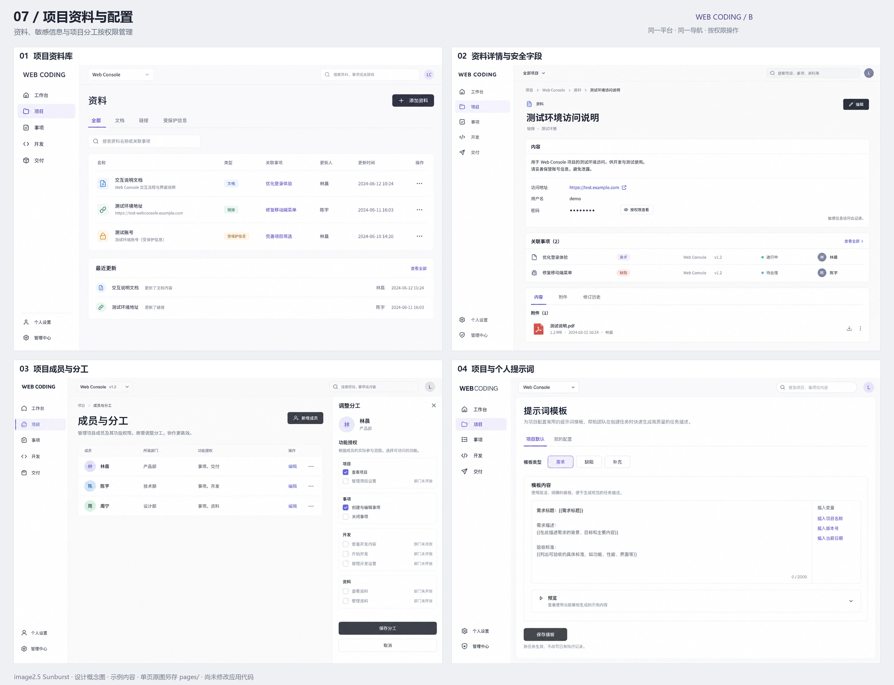

| 编号 | 界面 | 原型入口 | 参考图 |
| --- | --- | --- | --- |
| 07.1 | 项目资料库 | [查看](../prototypes/ui-refactor/review.html#assets) | [原始尺寸](assets/ui-refactor/pages/07-assets.webp) |
| 07.2 | 资料详情与安全字段 | [查看](../prototypes/ui-refactor/review.html#asset) | [原始尺寸](assets/ui-refactor/pages/07-asset-detail.webp) |
| 07.3 | 项目成员与分工 | [查看](../prototypes/ui-refactor/review.html#members) | [原始尺寸](assets/ui-refactor/pages/07-members.webp) |
| 07.4 | 项目与个人提示词 | [查看](../prototypes/ui-refactor/review.html#prompts) | [原始尺寸](assets/ui-refactor/pages/07-prompts.webp) |

## 08 · 个人设置与接入

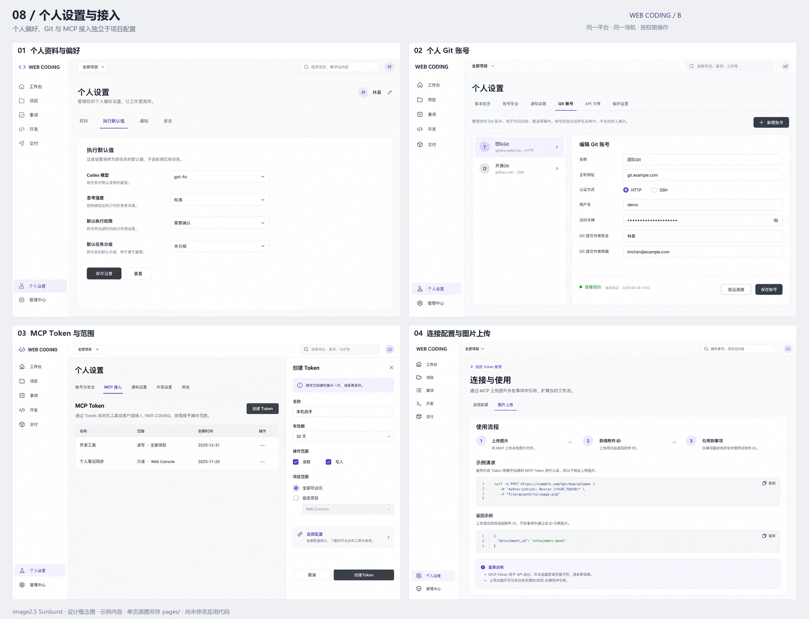

| 编号 | 界面 | 原型入口 | 参考图 |
| --- | --- | --- | --- |
| 08.1 | 个人资料与偏好 | [查看](../prototypes/ui-refactor/review.html#personal) | [原始尺寸](assets/ui-refactor/pages/08-personal.webp) |
| 08.2 | 个人 Git 账号 | [查看](../prototypes/ui-refactor/review.html#git) | [原始尺寸](assets/ui-refactor/pages/08-git-accounts.webp) |
| 08.3 | MCP Token 与范围 | [查看](../prototypes/ui-refactor/review.html#tokens) | [原始尺寸](assets/ui-refactor/pages/08-mcp-tokens.webp) |
| 08.4 | 连接配置与图片上传 | [查看](../prototypes/ui-refactor/review.html#mcp-guide) | [原始尺寸](assets/ui-refactor/pages/08-mcp-guide.webp) |

## 09 · 组织与平台管理

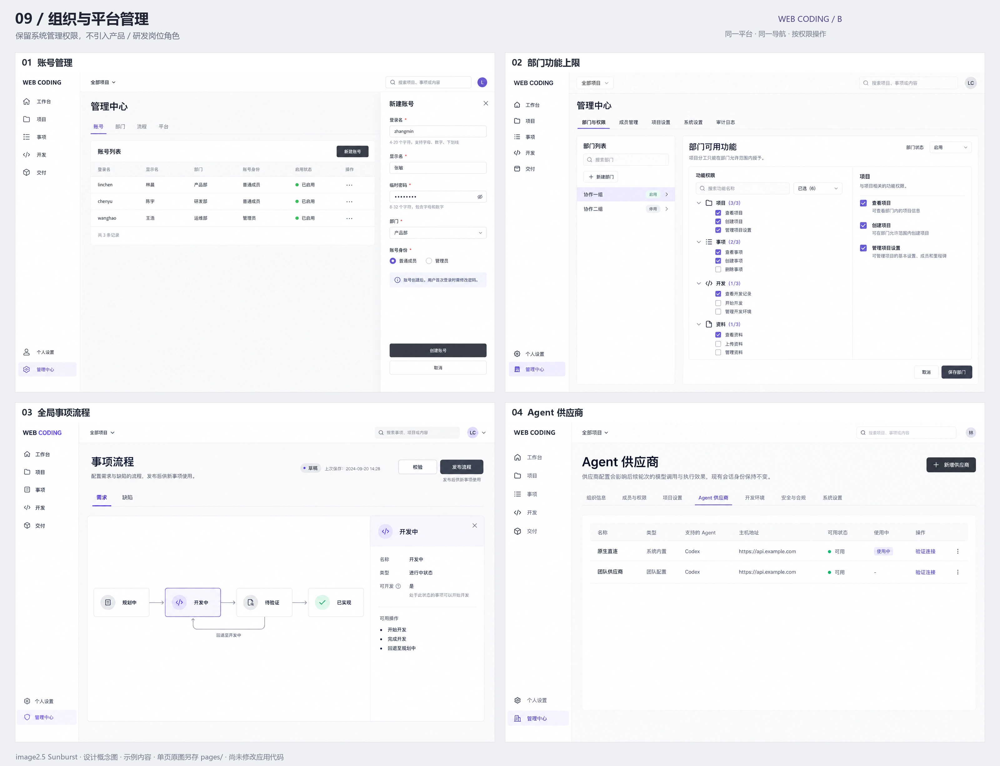

| 编号 | 界面 | 原型入口 | 参考图 |
| --- | --- | --- | --- |
| 09.1 | 账号管理 | [查看](../prototypes/ui-refactor/review.html#accounts) | [原始尺寸](assets/ui-refactor/pages/09-accounts.webp) |
| 09.2 | 部门功能上限 | [查看](../prototypes/ui-refactor/review.html#departments) | [原始尺寸](assets/ui-refactor/pages/09-departments.webp) |
| 09.3 | 全局事项流程 | [查看](../prototypes/ui-refactor/review.html#workflow) | [原始尺寸](assets/ui-refactor/pages/09-workflow.webp) |
| 09.4 | Agent 供应商 | [查看](../prototypes/ui-refactor/review.html#suppliers) | [原始尺寸](assets/ui-refactor/pages/09-suppliers.webp) |

## 10 · 运行平台与系统配置

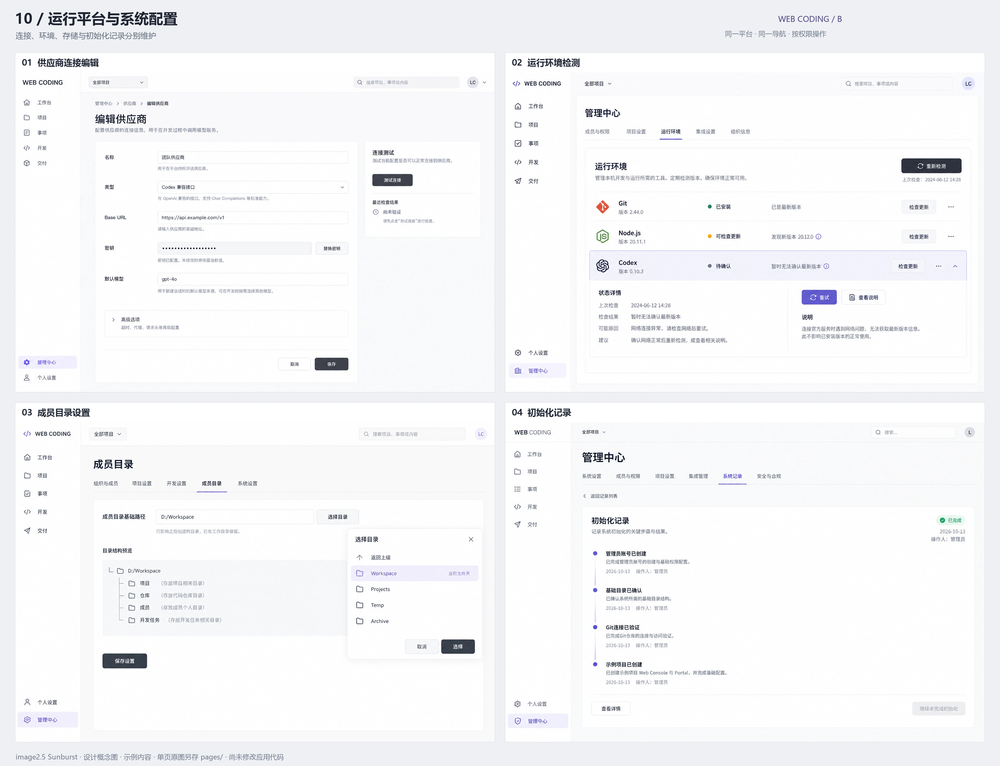

| 编号 | 界面 | 原型入口 | 参考图 |
| --- | --- | --- | --- |
| 10.1 | 供应商连接编辑 | [查看](../prototypes/ui-refactor/review.html#supplier) | [原始尺寸](assets/ui-refactor/pages/10-supplier-editor.webp) |
| 10.2 | 运行环境检测 | [查看](../prototypes/ui-refactor/review.html#environment) | [原始尺寸](assets/ui-refactor/pages/10-environment.webp) |
| 10.3 | 成员目录设置 | [查看](../prototypes/ui-refactor/review.html#storage) | [原始尺寸](assets/ui-refactor/pages/10-storage.webp) |
| 10.4 | 初始化记录 | [查看](../prototypes/ui-refactor/review.html#init-log) | [原始尺寸](assets/ui-refactor/pages/10-initialization-record.webp) |

## 11 · 账号与首次使用

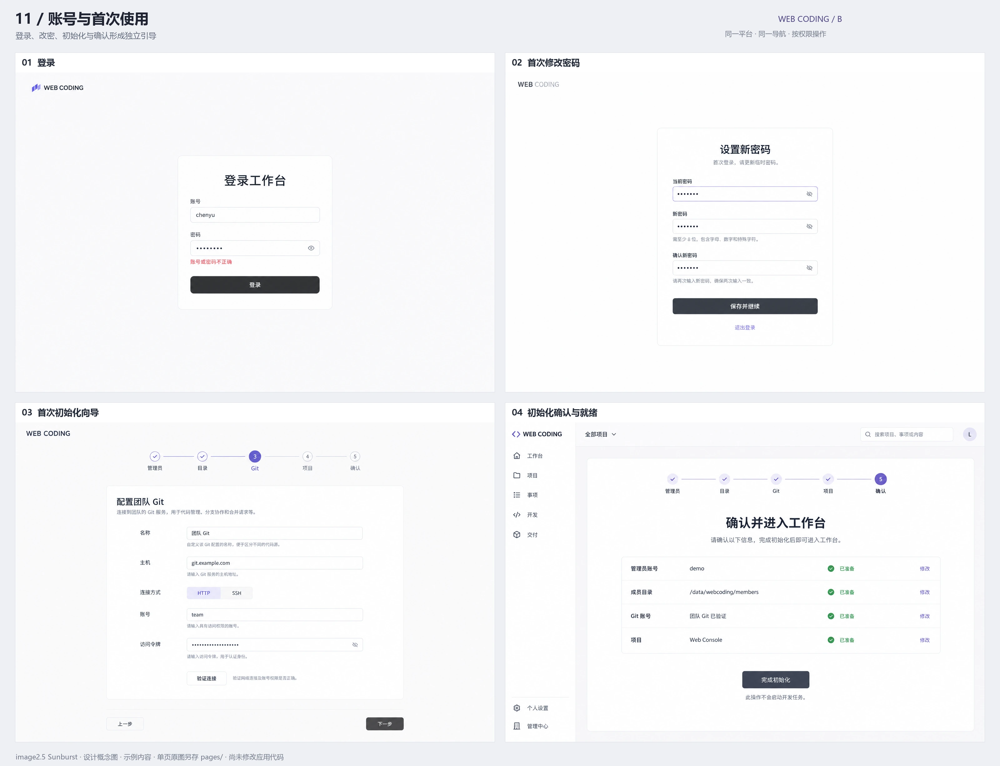

| 编号 | 界面 | 原型入口 | 参考图 |
| --- | --- | --- | --- |
| 11.1 | 登录 | [查看](../prototypes/ui-refactor/review.html#login) | [原始尺寸](assets/ui-refactor/pages/11-login.webp) |
| 11.2 | 首次修改密码 | [查看](../prototypes/ui-refactor/review.html#password) | [原始尺寸](assets/ui-refactor/pages/11-password.webp) |
| 11.3 | 首次初始化向导 | [查看](../prototypes/ui-refactor/review.html#setup) | [原始尺寸](assets/ui-refactor/pages/11-setup-wizard.webp) |
| 11.4 | 初始化确认与就绪 | [查看](../prototypes/ui-refactor/review.html#setup-summary) | [原始尺寸](assets/ui-refactor/pages/11-setup-summary.webp) |

## 12 · 冲突、异常与移动端

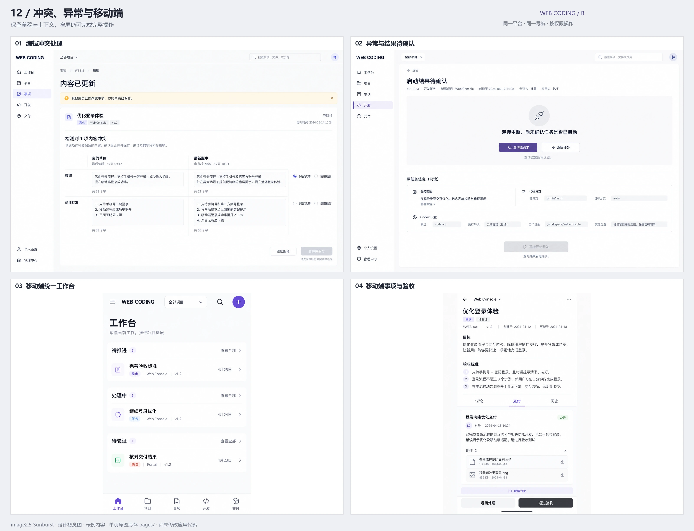

| 编号 | 界面 | 原型入口 | 参考图 |
| --- | --- | --- | --- |
| 12.1 | 编辑冲突处理 | [查看](../prototypes/ui-refactor/review.html#conflict) | [原始尺寸](assets/ui-refactor/pages/12-edit-conflict.webp) |
| 12.2 | 异常与结果待确认 | [查看](../prototypes/ui-refactor/review.html#uncertain) | [原始尺寸](assets/ui-refactor/pages/12-uncertain-operation.webp) |
| 12.3 | 移动端统一工作台 | [查看](../prototypes/ui-refactor/review.html#home)（窄屏） | [原始尺寸](assets/ui-refactor/pages/12-mobile-home.webp) |
| 12.4 | 移动端事项与验收 | [查看](../prototypes/ui-refactor/review.html#issue)（窄屏） | [原始尺寸](assets/ui-refactor/pages/12-mobile-issue.webp) |
