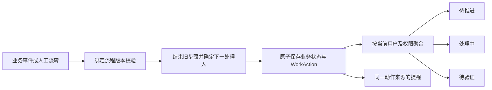

# 工作台队列、人员职责与流程动作定义

日期：2026-10-14。状态：目标规则，首个职责与工作台切片已实施；其余目标仍按阶段推进。与[研发全流程方案](./tapd-alignment-and-orchestration.md)配套，允许重构现有模型、接口与页面，不兼容旧业务数据。

## 1. 工作台要回答的问题

工作台告诉当前用户：现在需要我推进什么、我已经在做什么、什么结果需要我验证。栏目按“我的处理动作”分类，不能分别等同于需求表、开发任务表、交付表。

每条工作必须同时说明：**为什么轮到我、具体做什么、当前卡在哪里、完成后交给谁**。

拥有项目查看权限、是事项创建人、在关注列表里、拥有系统管理员身份，都不会自动产生个人待办。项目总览和“我关注的”承担跟踪职责。

## 2. 重构前模糊点的代码依据

| 当前栏目/行为 | 实际规则 | 造成的歧义 |
| --- | --- | --- |
| 待推进 | 事项未处于完成/取消，且本人是开发负责人、创建人或 `participantIds` 成员 | 我创建但已交给别人处理的需求还一直算我的待办 |
| 处理中 | 本人的任务排除 merged/completed/cancelled | planned 待开发和 unknown 待确认也算处理中；不读取实际 Agent 轮次就无法判断是否正在运行 |
| 待验证 | 有协作及事项查看权限项目中的全部 pending 交付 | 既未限定当前验证人，也未要求当前用户具有验收操作权限；可能看到“开始验证”却不能执行 |
| 交付“与我有关” | `authorId = 当前用户` | 实际是我提交的交付，不能表达轮到我验收 |
| 查看全部 | 首页事项/tasks 使用 active 过滤，跳转和队列查询未保留同样过滤 | 首页数字与展开后列表范围不一致 |
| 人员和时间 | 主要显示开发负责人/交付作者/执行人及创建日期 | 看不出当前处理人、交接时间、截止时间和下一动作 |
| 顶部提醒 | 另按验收权限查项目 pending 交付、本人会话审批/问题 | 首页和通知不是同一份个人动作集合 |

证据：[首页](../../web/src/features/projects/WorkbenchHome.vue)、[列表](../../web/src/features/projects/WorkQueue.vue)、[聚合查询](../../src/storage/workbench-store.cjs)、[查询授权](../../src/application/workbench-services.cjs)、[行展示](../../web/src/features/projects/WorkItemList.vue)、[提醒](../../src/application/attention-services.cjs)。以上为静态核对，未操作生产事项。

## 3. 三栏的固定语义

栏目名称保留，并显示说明：“待推进 · 需要我采取行动”“处理中 · 我已开始的工作”“待验证 · 需要我核验的成果”。

| 栏目 | 进入条件 | 典型内容 | 退出条件 | 主要按钮 |
| --- | --- | --- | --- | --- |
| 待推进 | 当前明确分派给本人、非验证类、已就绪但未开始；或处理中暂停且需要本人作出下一决定 | 需求补充/评审/排期、Bug 分诊、待开始子任务、待启动开发、Agent 审批/问题、结果待确认、整理成果、返工、发布审批 | 开始实质处理、提交交接、取消、改派，或转为等待他人 | 补充资料、提交评审结论、安排计划、开始开发、处理审批、核对原执行、整理成果 |
| 处理中 | 本人已明确开始的非验证类动作未完成，且未停在需要本人决策或等待他人的节点 | 正在澄清/方案处理、正在执行的业务子任务、真实运行中的 Agent、正在执行的发布操作 | 完成/交接/取消/改派；需要本人决定转待推进；等待别人转等待区 | 继续处理、查看进度、按权限停止 |
| 待验证 | 当前分派给本人的质量验证或业务验收动作，前置资料已齐全，状态为待开始或验证中 | 测试执行、Bug 回归、交付验收、需求业务验收、上线后验证 | 提交通过/退回/阻塞结论、取消、改派或被新修订替代 | 开始验证、继续验证、记录结果 |

“待验证”包含正在验证，行内必须显示“待开始/验证中”，不再把同一验证动作搬到处理中；完整列表提供这两个筛选。需求评审和发布审批是决策，不是成果质量验证，属于待推进/处理中。

打开详情不等于开始处理。人工步骤由“开始处理/开始验证”受理；短决策可以从待推进直接提交结论。开发以真实执行开始事件进入处理中，点击按钮及准备受理不能伪装成已运行。

Agent 正在启动/准备且后端明确确认操作仍在进行时，可以显示处理中并标注“准备环境”，但不能声称 Agent 已开始；结果未知或准备失败转待推进“核对原执行/处理准备失败”，禁止自动再次启动。

## 4. 主三栏之外的范围

| 范围 | 内容 | 是否计入三栏 |
| --- | --- | --- |
| 等待他人 | 我发出的工作已经交给别人；我承担的工作因外部依赖阻塞 | 否；显示等待对象、当前责任人、等待原因和时长 |
| 我关注的 | 我提报、负责结果或主动关注的事项动态，但当前无需我执行动作 | 否；属于跟踪，不等于待办 |
| 可认领 | 当前成员符合候选规则、尚未被认领的共享步骤/子任务 | 否；认领成功才进入个人栏目 |
| 已完成 | 本人已完成、撤销或被替代的动作历史 | 否；可追溯原对象和轮次 |
| 项目待分派/流程异常 | 处理人缺失、停用、撤权或规则无法解析 | 只给明确的流程协调人生成“处理分派异常”待推进，不广播给全部用户 |

等待中的动作若现在就需要本人解除阻塞，例如补交资料或批准权限，应生成/恢复本人待推进动作，不能藏在等待区。真正等待外部依赖的动作保留责任记录，但不计为可行动的个人待办。

个人三栏保持同一套界面。管理员或项目负责人可以在项目视图查看全局进度，但个人首页不会因为权限更大而装入全项目任务。

## 5. 人员和分派规则

人员定义以[全流程方案第 4 节](./tapd-alignment-and-orchestration.md#4-人员字段与职责)为准。页面不用“参与人”混合表达协作者、处理人和订阅者。

1. 每个可行动步骤有明确的受理方式：指定个人、候选池认领、多人分别处理。默认处理人可以引用业务负责人、测试负责人、验收人、发布负责人或显式项目组。
2. 事项业务负责人对结果负责；开发任务执行人对本次开发负责；当前处理人来自当前步骤。三者可以不同，不能用一个 `assigneeId` 替代。
3. 关注人和提报人不自动进入待办。需要其补充资料时，创建明确的“补充资料”动作。
4. 候选组是项目内显式配置的人员集合，不直接使用部门名称作为产品/开发/测试角色。
5. 指派时及执行动作时都检查有效账号、项目访问、操作权限及对象写保护。转派更新未结束动作并保留日志；旧处理人不能提交迟到结果。
6. 人员撤权/停用立即失去可执行待办和敏感读取；相关动作进入分派异常，由流程协调人修复，不能悄悄被视为已完成。
7. 多人会签给每人生成独立动作；全部通过才能完成步骤。任一通过模式中，首个合法结论结束同轮剩余候选动作，迟到提交返回冲突。
8. 允许一人兼任多个职责，但模板可以要求独立验收。启用独立验收时排除交付作者/对应开发执行人；没有合格人员则阻止提交验收并说明缺项。
9. 交付作者默认查看“等待验收”；只有被明确指定、具有权限且符合独立验收规则时，才进入自己的待验证。
10. 项目创建时必须确定流程协调人；其离职/停用前交接。规则不能产生无人负责且无人可处理的孤立动作。

## 6. 每条记录显示什么

桌面列表和移动条目使用相同业务信息，按空间折叠次要字段。

| 内容 | 示例/规则 |
| --- | --- |
| 动作标题 | “验证登录超时修复”，优先于只显示“登录超时” |
| 工作对象 | Bug #128 / 交付第 2 次修订 / 业务子任务 / 发布 v1.2；提供原对象深链 |
| 项目、迭代、版本 | 有值才显示，未排期明确标注；不把流程版本显示成产品版本 |
| 当前步骤及进度 | 待分诊、修复中、待开始验证、验证中、等待审批、执行结果待确认 |
| 为什么给我 | “你是本次回归处理人”“由李四指派给你”“等待你答复 Agent” |
| 当前处理人与提交人 | 验证列表显示处理人和交付提交人，不能只显示作者头像冒充当前责任人 |
| 优先级和时限 | 动作优先级、截止日期、已逾期/剩余时间；时限规则明确，缺日期不编造 |
| 最近交接 | “今天 10:20 提交给你”，创建日期放详情，不作为默认排序依据 |
| 阻塞信息 | “缺少测试环境”“等待 CI 结果”；能由本人解除的提供对应动作 |
| 下一步 | “验证通过后交给业务验收人王五”或“退回开发执行人张三” |
| 主动作 | 由服务端返回的允许动作决定；只读显示“查看详情”，不能仍写“开始验证” |

首屏每栏默认最多 5 条并显示准确总数；完整列表保留栏目、项目、动作类型、处理状态、关键词等条件。默认按需要立即处理的阻塞决定 → 逾期 → 优先级 → 最近到期 → 最早交接排序，最后用稳定 ID 打破平局。验证队列内“验证中”可筛选，不覆盖紧急程度排序。

## 7. 工作台与编排器怎样一致

编排器定义业务语义，运行时产生动作，工作台只汇总动作，不根据状态中文名称猜测。

建议每个步骤配置 `actionCategory`（澄清、评审、规划、开发、返工、QA、业务验收、发布审批、发布执行等）、分派规则、时限、输入/完成规则。验证分类映射到待验证；其他分类按动作运行阶段映射待推进或处理中。自定义名称不改变分类。

`WorkAction` 至少保存：项目、目标对象及修订、流程/步骤实例、轮次、动作类别、处理人、受理方式、状态、来源事件、分派/开始/结束时间、截止时间和完成结果。通知使用同一动作身份。

同一对象可同时有多个合法步骤，例如前后端并行，不能按事项 ID 简单去重。个人计数以独立责任动作计数：同一动作的事项入口、任务入口、通知入口不能重复计数。执行中的 Agent 若暂停等待阻塞审批/提问，主开发动作暂停，展示该轮“处理审批/回答问题”动作；处理完成后关闭阻塞动作并恢复主动作，不在两栏重复计算同一项开发责任。非阻塞问题作为运行中动作的子提示，不把仍在执行的任务移出处理中。

多条子任务合并到同一个开发执行任务时，对同一执行人汇总为一个执行动作，行内列出涉及的子任务。事项只作为关联上下文；若同一事项还有独立的评审责任，则仍可另有一条动作。

测试通过后交接业务验收：QA 的动作完成并从其三栏退出；业务验收人的待验证新增一条。验证失败：关闭本轮验证动作，给明确的返工处理人新增待推进；验证人只在再次提交新修订后收到新一轮验证动作。

### 7.1 分类判定顺序

1. 先验账号、项目、对象可见性及本动作处理资格；归档、结束、撤销、已被替代的不进个人三栏。
2. 非本人明确受理的：按条件进入可认领或关注范围，不放入三栏。
3. 真正等待外部依赖的：进入等待他人，保留当前责任和阻塞原因。
4. QA/回归/业务验收/上线核验：待验证，区分待开始和验证中。
5. 其他正在进行且没有停在本人决策点的：处理中。
6. 其他已就绪、返工或需要本人决策的：待推进。

分类从服务端共同规则返回；非法/未知动作状态显示异常并交给协调人，不降级成成功、完成或空列表。

### 7.2 查询、数字和提醒

首轮已实现 `GET /api/workbench/actions?bucket=todo|doing|verify`，同一响应返回当前筛选下的三栏计数；首页、完整队列和提醒共用规则。`/workbench/issues|tasks|deliveries` 继续用于资源浏览。以下条目描述完整目标，实际响应与已完成行为以[流程动作契约](../engineering/workflow-actions.md)为准。

- 返回处理动作 ID、目标对象、分派原因、当前阶段、时限、可用动作、阻塞原因和详情链接；不能把私人运行内容放入公开摘要。
- 首页、查看全部、顶栏提醒共用同一查询规则及当前用户身份。提醒是新增/变更动作的提示，不是额外一份待办。
- 同一响应中的列表与总数使用相同筛选、权限和一致性快照；分页结果按稳定排序。翻页后业务有变化时显示刷新提示，不伪装固定快照。
- 完成操作后服务端返回动作变化，前端移除旧项并刷新受影响栏目；账号/项目切换后的迟到响应丢弃。
- 加载失败不显示 0，也不显示“已经处理妥当”；无权限、未分派和真正无待办使用不同空状态。
- 未读是阅读状态，待办是业务状态。打开消息、关闭通知、切换页面不完成动作；同一事件重试不重复通知。
- 当前没有明确验证人的新交付不能提交验收；不通过“显示给所有有验收权限的人”补齐缺失数据。

## 8. 按实际场景验收

以下角色用于举例，系统仍按明确分派和权限判断，不根据职位名称切换界面。

| 场景 | 用户甲看到什么 | 用户乙看到什么 | 必须成立的规则 |
| --- | --- | --- | --- |
| 甲提报需求，乙负责澄清 | 关注/等待，无个人待办 | 待推进：澄清需求 | 创建人不自动承担下一步 |
| 乙要求甲补充说明 | 待推进：补充资料 | 等待甲补充 | 等待动作有责任人和原因 |
| 产品甲把子任务交给开发乙 | 关注开发进度 | 待推进：开始开发 | 未启动不进入处理中 |
| 乙明确开始、Agent 真正运行 | 甲仍只看公开进度 | 处理中：开发任务 | 准备/运行/未知分别展示 |
| Agent 阻塞等待乙批准或回答 | 甲不看到私人请求 | 待推进：处理审批/回答问题 | 开发主动作暂停，不重复计数 |
| Agent 返回结果但乙未整理 | 甲不看到已交付或验收成功 | 待推进：整理成果 | 工具完成不等于业务完成 |
| 开发乙交付，测试甲验证 | 待验证：开始验证 | 等待甲验证 | 交付作者不自动进入待验证 |
| 甲正在验证 | 待验证：验证中 | 等待甲验证 | 不同时出现在处理中 |
| 甲退回给乙 | 关注返工进展 | 待推进：返工 | 本轮验证结束，重提后才开下一轮 |
| QA 甲通过，产品乙业务验收 | 已完成验证 | 待验证：业务验收 | 质量验证和业务验收分开 |
| 甲有查看权限但非处理人 | 可在项目详情查看 | 被指派的乙有待办 | 不出现误导的开始/通过按钮 |
| 管理员甲未承担任何步骤 | 个人三栏为空，可看项目总览 | 成员乙正常看到自己任务 | 管理权限不等于分派 |
| 甲只被加入关注列表 | 动态/关注范围 | 乙的处理责任不变 | 关注不改变责任和权限 |
| 甲乙都可认领同一步骤 | 两人先在可认领看到 | 仅认领成功者进入三栏 | 并发认领只有一次成功 |
| 甲乙各自承担并行会签 | 各有一条自己的动作 | 各有一条自己的动作 | 不按事项 ID 错误去重 |
| 旧交付被新修订替代 | 旧动作撤销，新修订新动作 | 作者看到新的等待对象 | 旧结论不能验收新修订 |
| 执行状态未知 | 只对执行人显示核对原执行 | 其他人只看授权摘要 | 无自动重放或“重新开始”捷径 |
| 处理人停用或撤权 | 原人失去动作与敏感读取 | 协调人收到分派异常 | 不消失成无人负责，也不自动完成 |
| 项目/版本归档 | 三栏移除，历史按权限可读 | 同样受归档保护 | 归档门禁先处理未结动作 |
| 同用户兼任开发和测试 | 依显式分派生成动作 | 不适用 | 若独立验收开启，禁止给自己验证自己的交付 |

## 9. 首期实施边界

先落实人员、动作和队列的统一模型，并接入现有需求/Bug、开发、交付场景；后续增加迭代、测试计划、发布时只新增动作类别和对应业务步骤，不再改三栏语义。

实现涉及：事项表单/详情与人员选择、项目默认职责、开发任务受理及真实运行事件、交付验证分派与返工、工作台聚合、顶部通知、权限目录和数据库基线。仅修改“待推进/处理中/待验证”文案或前端状态过滤，不能满足本方案。

验收必须同时检查服务端查询、逐用户权限、动作去重与计数、首页/全部/通知一致性、并发交接、人员变化、未知执行以及窄屏展示。所有场景使用模拟账号、隔离数据库和 fake Agent，不操作真实需求。
