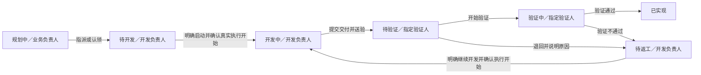

# 事项、开发与交付流转闭环方案

日期：2026-10-15。状态：用户已批准并实施；最终行为以[流程动作契约](../engineering/workflow-actions.md)为准。

本方案依据当前代码、工程契约及本地配置数据库中「测试」项目的只读查询形成。用户已明确允许不兼容历史业务数据，可以调整字段和数据结构；随后已授权按本方案实施。代码和隔离测试已更新，现有业务数据库未部署或清理。

## 1. 结论

当前问题是业务交接缺少统一规则：认领与指派修改开发负责人，开始执行修改开发任务，发布与验证修改交付，事项状态及当前步骤处理人却需要另外维护。

建议以「业务动作」为入口，在一次提交中完成相应的成果记录、事项流转、人员交接和待办更新。事项、开发任务、Agent 执行、交付仍分别记录事实，通过明确规则衔接。

默认事项详情删除独立的「开始处理」按钮。人工流转显示「当前状态 → 目标状态」「当前处理人 → 下一处理人」和本次必填资料。开发、提交验证、验证通过等动作使用对应业务入口，不再让用户为同一件事重复修改状态。

本项目不与 TAPD 同步；本方案采用目标状态、人员交接和受控流转的交互方式，不主张逐项复制 TAPD 的配置模型。

## 2. 测试数据中的实际断点

本地数据包含 1 个项目、3 条事项、3 个开发任务、2 条交付；事项均绑定需求流程 v1。以下时间使用北京时间，日期均为 2026-10-15。

| 样本 | 已核对事实 | 暴露的问题 |
| --- | --- | --- |
| #2「测试」 | 开发负责人为「测试#研发」，任务已完成；事项仍为「规划中」，当前步骤仍交给管理员，且被标记为处理中 | 开发任务完成与事项进度没有衔接，旧处理人继续收到规划待办 |
| #3「测试1」 | 01:33:46 发布交付；01:34:05 又点步骤开始；01:34:06 才从开发中流转到待验证；开发任务仍为 started | 发布交付没有完成提交验证，用户必须重复操作 |
| #1「测试」 | 01:24:24 开始交付验证；01:24:35 交付通过，同时事项只从待验证转为验证中；01:24:45 再单独转为已实现 | 开始验证与事项验证状态分离；通过验收时还能选择与结论不相符的「开始验证」流转 |

「测试#研发」在部门及项目层面均有 `issue.transition` 权限。其无法推进规划中的事项，直接原因是当前节点指定业务负责人，后端仍要求当前节点处理人操作，前端也据此返回空流转列表。不是简单补一个权限勾选就能解决。

改造前代码依据（以下说明记录原问题）：

- [WorkActionStore](../../src/storage/work-action-store.cjs)：`start()` 只把步骤从 ready 改为 active，不变更事项状态。
- [事项服务](../../src/application/project-content-services.cjs)：流转要求当前节点处理人；发布交付不推进事项；验收只有可选的额外流转参数。
- [开发存储](../../src/storage/project-development-store.cjs)：分配维护开发负责人，完成释放认领，不推进事项。
- [交付详情](../../web/src/features/projects/DeliveryDetail.vue)：验收时另选「同时更新事项状态」，默认保持不变。

## 3. 推荐的默认流程

需求默认采用一次验证闭环。需要区分测试与业务验收的团队，可在流程中配置「测试通过 → 待业务验收 → 已实现」；业务验收人的字段有值，不代表自动启用第二级验收。Bug 可保留「已验证待关闭 → 已关闭」，关闭由业务验收人执行，测试动作无需再去详情页补状态。

| 用户动作 | 事项与人员的结果 | 工作台的结果 |
| --- | --- | --- |
| 新建事项 | 规划中，由业务负责人准备资料、安排开发 | 业务负责人待推进 |
| 指派／认领 | 创建待开发任务、记录开发负责人，按允许的连线转到待开发并交接处理人 | 开发负责人待推进，原规划动作结束 |
| 开始开发 | 先校验流程、资料和分派；真实执行开始后变为开发中 | 实际运行时开发人员看到处理中 |
| Agent 本轮结束 | 保持开发阶段；本轮结束不代表功能完成或验收通过 | 需要开发人员继续处理或整理成果 |
| 提交交付并送验 | 保存交付修订、明确验证人，事项转待验证并完成交接 | 验证人待验证；已提交范围不再重复提示整理成果 |
| 开始验证 | 同时记录验证开始并使事项进入验证中 | 仍在验证人的待验证栏目中，标明验证中 |
| 验证通过 | 保存验证结论，进入流程规定的完成节点或业务验收节点 | 当前验证动作结束；如有业务验收，交给业务验收人 |
| 退回修改 | 保存原因和退回修订，事项进入待返工，交回开发负责人 | 开发人员待推进，可继续原开发上下文 |
| 重新提交 | 创建后继交付修订、转待验证、产生新一轮验证动作 | 验证人收到新一轮待验证 |

认领表示接受工作，不能算已经开发。若某个自定义流程要求先评审，只有评审完成后允许认领交接；不允许借认领绕过评审。启动失败或结果未知时，不假定进入开发中，更不自动重跑。

## 4. 事项详情与交付页的交互

### 4.1 移除重复的「开始处理」

默认流程不再暴露独立的步骤 ready/active 开关。待开发、开发中、待验证、验证中已经表达业务阶段；需要的开始时间由真实开发开始、开始验证等动作记录。

自定义人工环节若确实需要「开始评审」，应配置成有目标状态的业务动作。按钮应清楚说明会进入什么状态，不能只改变一个与事项进度无关的标记。

### 4.2 人工流转展示交接结果

事项详情保留「状态流转」区域，展示：当前状态、当前处理人、允许到达的目标状态、下一处理人、所需资料和原因。选择目标后立即显示负责人来源及缺失项。

例如：`开发中 → 待验证；测试#研发 → 测试#产品`。提交按钮为「提交验证」或「更新状态并交接」，不以模糊的开始按钮代替。

需要交付证据的边，点击后进入交付表单或选择有效交付；不能只修改状态来绕过送验。人工调整状态仍有用途，例如退回规划、拒绝、重新打开，但须遵守配置的门禁并记录原因。

### 4.3 合并发布与送验

关联事项的主按钮改为「提交交付并送验」。表单明确列出本次覆盖的事项、交付说明、验证材料、验证人和提交后的状态。成功后直接跳转交付详情，不再提示用户去事项手动改待验证。

「保存草稿」如需提供，必须与送验分开；草稿不产生验证待办。独立开发成果没有关联事项时，只进入交付验证链，不虚构事项状态。

### 4.4 验证结论直接驱动流转

验收页去掉常规路径中可选的「保持当前状态／同时更新事项状态」。按钮显示「验证通过」和「退回修改」，目标由已发布流程确定，页面预览结果。

需要直接从待验证提交结论的流程，必须明确配置对应通过／退回边。不能把「验证通过」套到「开始验证」边上；也不能记录通过后让用户再补一次已实现。

交付验证人与该验证步骤的实际处理人保持一致。若流程指定 QA，选择其他验证人时，界面必须明确这是本轮验证转交，并在同一次操作中更新本轮分派；不能形成两个人各自拥有半套操作权。

## 5. 权限与人员交接

业务负责人、开发负责人、测试负责人、业务验收人继续分别表达职责；认领不能把业务负责人直接改成研发。

当前步骤处理人是「这一步交给谁」的权威记录。进入下一节点时，按节点默认职责及本次明确选择生成分派；人工交接、职责调整与步骤分派同步保存，避免临时查询一个角色字段推导出不同于待办的处理人。

| 操作 | 允许的业务身份 | 约束 |
| --- | --- | --- |
| 指派开发 | 具有指派权限的有效成员 | 校验目标开发资格及当前流程是否允许交接 |
| 自行认领 | 流程允许认领的有效开发成员 | 认领本人，检查唯一活跃认领及目标步骤资格 |
| 开始／继续开发 | 当前开发任务执行人 | 检查会话权限、事项阶段、任务归属与明确启动请求 |
| 提交交付并送验 | 当前开发执行人／流程允许的提交人 | 校验交付范围、发布权限、资料和目标验证人 |
| 验证与退回 | 本轮指定验证人 | 校验验证权限、最新交付修订与允许的结果边 |
| 转派／异常修复 | 有相应管理权限的协调人 | 显式交接并审计，不默认接管私人会话 |

开发人员不需要取得所有事项的通用管理权。流程若允许其在送验时选择下一处理人，应授予这条连线范围内的交接能力，只能选择有目标处理资格的人员、修改本轮对应分派。不能因为没有全局 `issue.assign` 就强迫其另找管理员，也不能因此开放任意人员字段编辑。

真实执行事件由已授权的开发启动动作产生，用限定能力的系统处理推进相应连线，并记录原操作人及事件来源。不能直接套用「必须是旧节点处理人」规则，也不能用管理员身份绕过全部门禁。

## 6. 流程编排需要补什么

已有的节点职责、工作类别、必填资料和验收门禁保留，重点补齐业务事件与流转的关系。

| 配置位置 | 配置内容 | 示例 |
| --- | --- | --- |
| 节点 | 默认处理职责、工作类别、允许的开发动作 | 允许认领／指派、允许启动、允许返工；取代含义过宽的单个允许开发开关 |
| 连线 | 触发方式 | 人工流转、认领／指派成功、真实开发开始、提交交付、开始验证、验证通过、验证退回 |
| 连线 | 操作主体 | 当前处理人、当前开发执行人、本轮验证人、具有指派权限的协调人 |
| 连线／目标节点 | 下一处理人规则 | 采用节点职责，或由本次交接明确选择有资格的成员 |
| 连线 | 业务条件与证据 | 必填资料、有效交付、对应验证结论、覆盖范围完成、退回原因 |
| 流转记录 | 来源和执行结果 | 用户动作／执行事件、旧新状态、旧新处理人、交付修订、成功或阻塞原因 |

以稳定节点／连线 ID 绑定事件，不识别中文状态名称。一个来源节点对同一事件只能有一个确定结果；多条候选但条件不能明确区分时，发布校验失败。

首期只支持上述固定业务事件和受控动作，不开放任意脚本、自动启动 Agent、自动 Git 合并或部署。发布前用模拟数据预览「事件 → 状态 → 下一处理人 → 待办」，保证配置可执行。

## 7. 数据结构调整方向

用户允许不兼容历史业务数据，因此可以直接纠正数据语义，不需要保留旧 API、旧字段别名、双写或历史业务回填逻辑。以下是模型职责，具体字段与接口在方案确定后设计。

| 对象 | 权威事实 | 调整方向 |
| --- | --- | --- |
| 事项 | 当前业务状态、绑定流程、长期职责 | 保留职责区分，当前步骤提供实际处理人；不再靠多个互不联动的字段判断下一步 |
| 流程版本 | 合法状态、触发事件、人员及门禁规则 | 在定义中明确动作语义，发布后保持不可变 |
| 当前步骤／WorkAction | 本轮处理人、轮次、进入／开始／结束时间 | 由业务动作维护；去掉用户独立切换通用处理中标记的路径，作为工作台和操作权的统一来源 |
| 开发任务及事项关联 | 开发范围、执行人、会话身份、各范围的交付进度 | 区分仍可返工的处理中任务与已正式结束任务；工作台阶段由真实执行和有效交付共同决定 |
| 交付修订 | 明确的事项范围、提交人、验证人、成果与证据 | 每次送验固定范围和修订，重新提交保留前后关系 |
| 验证记录 | 针对哪次交付、哪个验证环节的结论 | 与事项流转共同提交；需要测试和业务验收两级时分别记录，不能互相覆盖 |
| 事件／动作执行记录 | 去重身份、来源、处理结果、阻塞原因 | 支持重启恢复、旧事件隔离与只重试流转，不重跑开发 |

无需把所有对象合并成一个状态字段，也不需要在第一期建立复杂的通用 BPM 平台。数据结构为这条串行闭环服务。

## 8. 必须一起解决的边界

**开发结束与返工。** 当前完成开发任务会禁止后续继续会话。如果送验时直接套用这个终态，验证退回后仍然接不上。因此正常送验进入「等待验证」阶段，原任务与开发上下文保留；退回后进入「待返工」，由开发人员明确继续。全部关联范围通过最终验收且没有运行／审批／未知执行时，可按规则结束任务并释放认领。独立的提前结束属于例外动作，必须显示尚未交付范围的处置；历史已结束任务不能因退回而静默复活，需要显式建立返工关联。

**一任务、多事项。** 提交交付必须指定覆盖范围。第一期可仍以每条事项一份交付组织，表单支持同批提交；只推进被覆盖的事项。一个事项通过不能把整项合并开发标为完成。部分送验、部分退回、未交付内容分别可见，任务汇总阶段据此生成。

**真实执行与业务状态。** 外部 Agent 无法与数据库提交做同一原子事务。启动前校验流程，启动后只在持久化的真实开始事件上流转；事件按任务、事项、步骤轮次去重。若其间事项改动或授权变化，保留真实执行事实并显示流转阻塞，提供核对和仅重试流转入口。

**业务提交的一致性。** 发布送验、验证通过、退回以及本轮人员转派，都在短数据库事务中完成成果、状态、步骤和历史的保存。资料缺失、人员无效、修订冲突时整笔失败，页面保留草稿。通知失败不撤销已完成交接，只补发通知。

**当前修订有效。** 旧交付的通过不能关闭新一轮返工；已替代、已撤回或非当前范围的交付不能再推进事项。归档、停用、撤权、重复点击、跨账号操作和迟到事件均须重新校验。

**统一入口。** 事项详情、开发任务、整理成果、交付列表与任何发布 API 使用相同的交接规则；不能只修一个页面而让其他入口继续产生脱节数据。

## 9. 后续实施顺序与验收

1. 确定默认需求／Bug 流程、人员规则与任务结束语义，再细化字段、枚举、接口及数据库约束。
2. 实现统一的交接用例及触发规则，接入认领／指派、真实开发开始、送验、验证开始、通过、退回和重提。
3. 调整事项详情、开发任务、交付表单、验收页、流程编排和工作台，移除重复操作入口。
4. 以三位不同用户复现当前样本，补充多事项、返工、权限、冲突、幂等、未知执行和归档回归。
5. 同步工程契约和安装基线说明，完成隔离环境检查后，再安排新结构部署。

用户已允许不兼容历史业务数据，不设计在途事项迁移和旧版本业务兼容。已有已发布迁移如何归并或替换，实施时须同步部署契约；不能只改数据表却沿用不匹配的部署说明。本轮不会清库、重建业务数据或移动既有 session、source、Git 和 Worktree。

验收标准：从新建、指派／认领、明确开发、提交验证、验证通过到结束，正常路径不需要管理员补流转、不需要返回事项页手动改状态。开发人员只处理开发动作，验证人只处理本轮验证；退回能够回到明确的返工入口，同一范围不会重复产生规划、整理成果和验证待办。

实施后已通过 ESLint、620 项架构／单元／集成测试、构建及 Jenkinsfile 的全部 9 个浏览器入口；使用隔离 PostgreSQL、fake Codex 和临时 Git，不拿当前测试业务执行真实开发。覆盖范围和部署边界见[联动验收记录](../reviews/workflow-handoffs-2026-10-15.md)。
